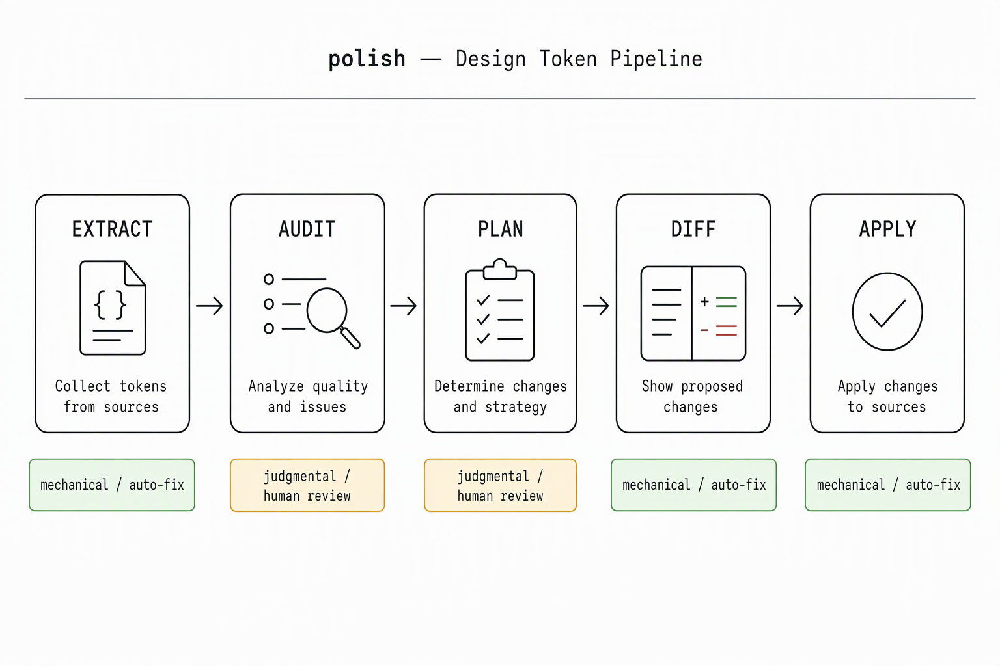

# polish — Design Token Superpower Tool

**Extract · Critique · Apply** — a zero-dependency toolkit that closes the loop on CSS custom properties (design tokens). It scans stylesheets for token problems, classifies each finding, and auto-applies mechanical fixes while flagging judgmental ones for human decisions.

Works as a CLI, an MCP server for AI coding agents, or a Node.js module.

**Repository**: [https://github.com/maxdeng007/polish-design-tokens](https://github.com/maxdeng007/polish-design-tokens)



## Problem

Design tokens — CSS custom properties like `--color-primary` — are powerful but fragile. As projects grow, tokens drift: hardcoded colors creep in, duplicate values appear under different names, references dangle, and cascade overrides silently break consistency. Detecting these issues manually is tedious; fixing them is even more so.

**polish** automates the audit → fix pipeline:

1. **Extract** — scan CSS/HTML files, build a declaration graph
2. **Critique** — cross-reference declarations and references to find problems
3. **Apply** — generate and execute patches for mechanical fixes, with backups

## Installation

**From npm** (recommended):

```bash
npm install -g polish-design-tokens
```

Or as a project dependency:

```bash
npm install polish-design-tokens --save-dev
```

**From GitHub** (if you want the latest source):

```bash
git clone https://github.com/maxdeng007/polish-design-tokens.git
cd polish-design-tokens/polish-mono
npm install -g .
```

Requires Node.js ≥ 18.

## Quick Start

```bash
# 1. Audit a project for token issues (via MCP or Node API — see below)
# 2. Convert findings to a ranked plan
polish plan findings.json > plan.json

# 3. Generate mechanical patches
polish diff plan.json > patches.json

# 4. Apply patches (creates .backup files automatically)
polish apply patches.json
```

## AI Agent Deployment

The most common workflow: give your AI coding agent (Qoder, Claude, etc.) the GitHub repo URL and ask it to set up and run polish. The agent will:

1. Clone the repo or install from npm
2. Register the MCP server (see below)
3. Use `polish_audit` to scan the target project
4. Use `polish_plan` → `polish_diff` → `polish_apply` to fix mechanical issues

All commands are idempotent and backed up — no risk of data loss.

## The Pipeline

polish operates in three phases. Each phase reads the output of the previous one, so you can run the full chain or stop at any point.

```
findings.json → [polish plan] → plan.json → [polish diff] → patches.json → [polish apply] → files
```

### 1. Plan — classify and rank

Takes findings (from `polish_audit` or token-audit) and produces an ordered action queue. Each finding is classified as:

- **Mechanical** — safe to auto-fix. No human decision needed.
- **Judgmental** — requires human judgment. Surfaced for manual review.

Findings are ranked by priority:

| Priority | Type | Description | Classification |
|----------|------|-------------|----------------|
| 1 | `conflict` | Same token name with different values in root scope | Judgmental |
| 2 | `dangling` | Token referenced but never declared | Mechanical |
| 3 | `runtime-drift` | Inconsistent token values across pages at runtime | Judgmental |
| 4 | `orphan` | Declared but never referenced | Judgmental |
| 5 | `duplicate-value` | Multiple token names sharing the same value | Mechanical |
| 6 | `namespace` | Multiple naming families coexist | Judgmental |
| 7 | `hardcoded` | Raw color/space values used instead of token references | Mechanical |
| 8 | `cascade-override` | CSS cascading produces unintended variation | Judgmental |
| 9 | `state-variation` | Token values differ across component states | Judgmental |
| 10 | `theme-variation` | Token values differ across themes | Judgmental |
| 11 | `dynamic-variable` | Tokens with dynamic (non-static) values | Judgmental |

Only **mechanical** findings (`hardcoded`, `duplicate-value`, `dangling`) produce patches in the next phase.

### 2. Diff — generate patches

Reads the plan and generates concrete patches for mechanical items only. Each patch specifies:

- **type**: `replace` (before → after), `add` (insert new declaration), `rename`, or `rewrite`
- **file** / **line**: exact location
- **before** / **after**: the exact text change
- **reason**: human-readable explanation

Patches for `duplicate-value` target the **secondary** token's location and alias it to the primary — never the primary itself (preventing self-referencing aliases).

### 3. Apply — execute with backup

Applies patches to files with automatic backup protection. Each file is backed up before modification. The result reports what was applied and any failures.

## CLI Usage

```bash
polish plan  <findings.json>   # Convert findings to an ordered action list
polish diff  <plan.json>       # Generate mechanical patches from a plan
polish apply <patches.json>    # Apply patches (creates .backup files)
polish mcp                     # Start MCP server (JSON-RPC over stdin/stdout)
```

## MCP Server

polish exposes 8 tools via the Model Context Protocol, so any AI coding agent (Qoder, Claude, etc.) can drive the full pipeline.

Add to your MCP config (`mcp.json`, `.mcp.json`, or your agent's config):

```json
{
  "mcpServers": {
    "polish": {
      "command": "polish",
      "args": ["mcp"]
    }
  }
}
```

If `polish` is not on the agent's PATH, use `npx` instead:

```json
{
  "mcpServers": {
    "polish": {
      "command": "npx",
      "args": ["-y", "polish-design-tokens", "mcp"]
    }
  }
}
```

Available tools:

| Tool | Description |
|------|-------------|
| `polish_extract` | Extract token declarations from a directory |
| `polish_audit` | Scan + cross-reference to produce findings |
| `polish_measure` | Normalize runtime observation data for audit |
| `polish_plan` | Convert findings to a ranked, classified action queue |
| `polish_diff` | Generate mechanical patches from a plan |
| `polish_apply` | Execute patches with backup protection |
| `polish_doctor` | Check required and optional dependencies |
| `polish_style_lookup` | Find tokens by name or pattern |

## Node.js API

```javascript
import { plan, generateDiffs, apply } from 'polish-design-tokens';
import { extract, audit, runPipeline, measure } from 'polish-design-tokens';

// Full pipeline: scan → audit → plan → diff (does NOT apply)
const { graph, findings, plan, patches } = runPipeline('./my-project');

// Manual step-by-step
const graph = extract('./my-project');
const report = audit('./my-project');
const actions = plan(report.findings);
const patches = generateDiffs(actions);
const result = await apply(patches);
```

## Static vs Runtime Analysis

**polish-design-tokens** performs **static analysis** — it scans source files (CSS, SCSS, HTML, JS/TS) to find token declarations, references, and conflicts. This works on any project, any environment, no extra setup required.

**Runtime measurement** (checking actual rendered values in a live browser) is a separate capability in the companion `token-audit-mcp` tool. It detects `runtime-drift` and `hardcoded` findings that only appear when tokens are evaluated in a real browser. This requires Chrome DevTools to be available and is not part of the npm package's default pipeline.

For most use cases — auditing a project's source, fixing mechanical issues, and verifying token consistency — the static pipeline in `polish-design-tokens` is sufficient. Use `token-audit-mcp` when you need to verify what users actually see in the browser.

## What It Finds

**Mechanical (auto-fixable by `polish diff` + `polish apply`):**

- **`hardcoded`** — Raw color or space values used directly instead of token references. Fix: replace with `var(--token-name)`.
- **`duplicate-value`** — Two or more token names share the same value. Fix: make secondary tokens alias the primary.
- **`dangling`** — A token is referenced but never declared. Fix: add a declaration with a default value.

**Judgmental (flagged for human review, no auto-patch):**

- **`conflict`** — Same token name declared with different values. Requires choosing a canonical value.
- **`cascade-override`** — Normal CSS cascading produces unintended value variation. Requires deciding whether to refactor or accept.
- **`namespace`** — Multiple naming conventions coexist (e.g. `--color-*` and `--bg-*`). Requires unifying naming.
- **`orphan`** — Declared but never referenced. Requires deciding to remove or keep.
- **`runtime-drift`** — Token values differ across pages when measured at runtime. Requires investigating the source.

## Why Use It

- **Closes the loop** — extract → critique → apply, no manual patching
- **Safe** — only mechanical fixes are auto-applied; judgmental ones are flagged
- **Backed up** — automatic file backups before any apply
- **Agent-ready** — MCP protocol lets any AI coding agent drive the pipeline
- **Zero dependencies** — pure JavaScript, works anywhere Node.js runs

## Repo Structure

| Directory | Description |
|-----------|-------------|
| `polish/` | Core tool: `plan.js`, `diff.js`, `apply.js` + CLI (`bin/polish.mjs`) |
| `polish-mcp/` | MCP server with tool handlers |
| `polish-mono/` | Unified npm package for distribution (`polish-design-tokens`) |
| `token-audit-mcp/` | Token audit MCP server (static scan + runtime measurement) |
| `examples/` | Sample projects with known token issues |
| `docs/` | Design specs and implementation plans |

## Examples

See [`examples/walkthrough/`](examples/walkthrough/) — a complete, runnable walkthrough of the full pipeline (audit → plan → diff → apply) on a demo project with real pipeline outputs, including a visual flow diagram and terminal screenshots.

Also see [`examples/noah-sample/`](examples/noah-sample/) — a rich test case covering all finding types, including a real-world stylesheet with duplicate values, hardcoded colors, and dangling references.

## License

MIT
