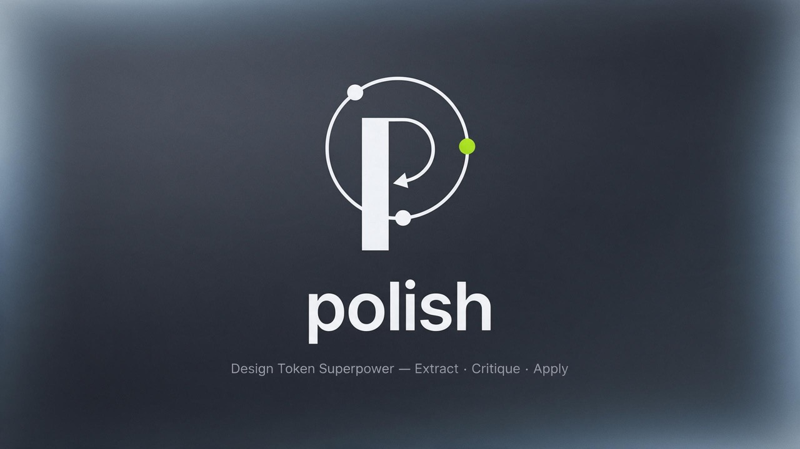
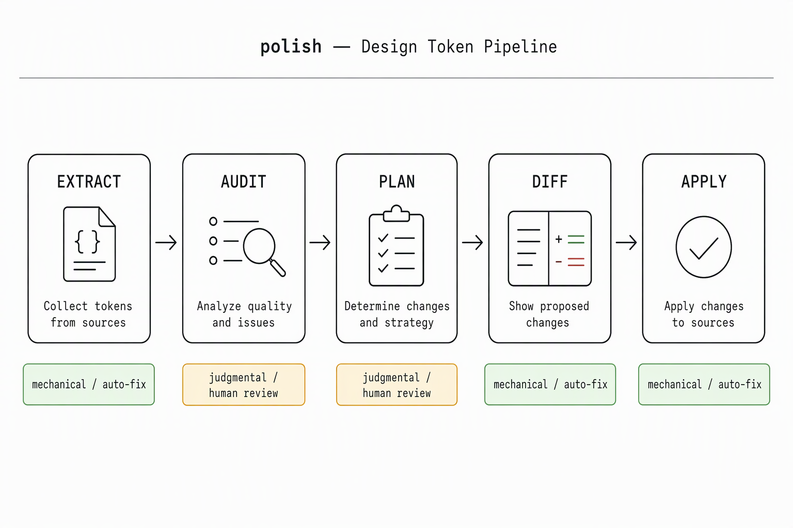

[English](README.md) | [中文](README.zh-CN.md)

# polish — 设计令牌超能力工具

**提取 · 审查 · 应用** — 一个零依赖工具包，闭环管理 CSS 自定义属性（设计令牌）。它扫描样式表中的令牌问题，对每条发现进行分类，自动应用机械性修复，同时将需要人工判断的问题标记出来交由人工决定。

可作为 CLI、AI 编程代理的 MCP 服务器，或 Node.js 模块使用。

**仓库**：[https://github.com/maxdeng007/polish-design-tokens](https://github.com/maxdeng007/polish-design-tokens)



## 问题

设计令牌——如 `--color-primary` 这样的 CSS 自定义属性——强大但脆弱。随着项目增长，令牌会发生漂移：硬编码颜色悄然出现，不同名称下出现重复值，引用悬空，层叠覆盖悄然破坏一致性。手动检测这些问题很繁琐，修复则更甚。

**polish** 将审计 → 修复流水线自动化：

1. **提取** — 扫描 CSS/HTML 文件，构建声明图
2. **审查** — 交叉比对声明与引用，发现问题
3. **应用** — 为机械性修复生成并执行补丁，附带备份

## 安装

**从 npm 安装**（推荐）：

```bash
npm install -g polish-design-tokens
```

或作为项目依赖：

```bash
npm install polish-design-tokens --save-dev
```

**从 GitHub 安装**（如果你想要最新源码）：

```bash
git clone https://github.com/maxdeng007/polish-design-tokens.git
cd polish-design-tokens/polish-mono
npm install -g .
```

需要 Node.js ≥ 18。

## 通过 AI 安装（无需编程）

如果你对上面的命令行不太熟悉，可以直接跳过。复制下方提示词，粘贴到任意 AI 聊天工具（ChatGPT、Claude 等）中，AI 就会帮你安装 polish 并审计你的项目——无需编程。

```text
请帮我用 "polish" 工具审计我项目中的设计令牌。

1. 运行以下命令全局安装 polish 工具：
   npm install -g polish-design-tokens

2. 对我以下项目目录运行审计：
   [在此处粘贴你的项目路径]

3. 用设计师能听懂的通俗语言汇报你的发现：
   - 存在哪些令牌问题（硬编码颜色、重复值、
     悬空引用、冲突等）
   - 哪些问题可以自动修复，哪些需要我来决定
   - 给出清晰的总结——不要原始 JSON

不要应用任何修复或修改任何文件。只安装、审计并汇报。
```

## 快速开始

```bash
# 1. 审计项目中的令牌问题（通过 MCP 或 Node API——见下文）
# 2. 将发现转换为排序后的计划
polish plan findings.json > plan.json

# 3. 生成机械性补丁
polish diff plan.json > patches.json

# 4. 应用补丁（自动创建 .backup 文件）
polish apply patches.json
```

## AI 代理部署

最常见的工作流：将 GitHub 仓库地址交给你的 AI 编程代理（Qoder、Claude 等），让它设置并运行 polish。代理会：

1. 克隆仓库或从 npm 安装
2. 注册 MCP 服务器（见下文）
3. 使用 `polish_audit` 扫描目标项目
4. 使用 `polish_plan` → `polish_diff` → `polish_apply` 修复机械性问题

所有命令均为幂等且有备份——无数据丢失风险。

## 流水线

polish 分为三个阶段。每个阶段读取上一阶段的输出，因此你可以运行完整链路，也可以在任何节点停止。

```
findings.json → [polish plan] → plan.json → [polish diff] → patches.json → [polish apply] → 文件
```

### 1. 计划 — 分类与排序

接收发现（来自 `polish_audit` 或 token-audit），生成有序的操作队列。每条发现被分类为：

- **机械性（Mechanical）** — 可安全自动修复。无需人工决策。
- **判断性（Judgmental）** — 需要人工判断。提交人工审查。

发现按优先级排序：

| 优先级 | 类型 | 描述 | 分类 |
|----------|------|-------------|----------------|
| 1 | `conflict` | 根作用域内同一令牌名有不同值 | 判断性 |
| 2 | `dangling` | 令牌被引用但从未声明 | 机械性 |
| 3 | `runtime-drift` | 运行时跨页面令牌值不一致 | 判断性 |
| 4 | `orphan` | 已声明但从未被引用 | 判断性 |
| 5 | `duplicate-value` | 多个令牌名共享同一值 | 机械性 |
| 6 | `namespace` | 多种命名族共存 | 判断性 |
| 7 | `hardcoded` | 直接使用原始颜色/间距值而非令牌引用 | 机械性 |
| 8 | `cascade-override` | CSS 层叠产生非预期的变异 | 判断性 |
| 9 | `state-variation` | 令牌值在不同组件状态间变化 | 判断性 |
| 10 | `theme-variation` | 令牌值在不同主题间变化 | 判断性 |
| 11 | `dynamic-variable` | 具有动态（非静态）值的令牌 | 判断性 |

只有**机械性**发现（`hardcoded`、`duplicate-value`、`dangling`）会在下一阶段生成补丁。

### 2. 差异 — 生成补丁

读取计划，仅为机械性条目生成具体补丁。每个补丁指定：

- **type**：`replace`（前 → 后）、`add`（插入新声明）、`rename` 或 `rewrite`
- **file** / **line**：精确位置
- **before** / **after**：精确的文本变更
- **reason**：人类可读的解释

`duplicate-value` 的补丁针对**次要**令牌的位置，将其别名到主要令牌——绝不针对主要令牌本身（防止自引用别名）。

### 3. 应用 — 带备份执行

应用补丁到文件，带自动备份保护。每个文件在修改前都会备份。结果报告已应用的内容和任何失败。

## CLI 用法

```bash
polish plan  <findings.json>   # 将发现转换为有序操作列表
polish diff  <plan.json>       # 从计划生成机械性补丁
polish apply <patches.json>    # 应用补丁（创建 .backup 文件）
polish mcp                     # 启动 MCP 服务器（stdin/stdout 上的 JSON-RPC）
```

## MCP 服务器

polish 通过 Model Context Protocol 暴露 8 个工具，因此任何 AI 编程代理（Qoder、Claude 等）都能驱动完整流水线。

添加到你的 MCP 配置（`mcp.json`、`.mcp.json` 或你的代理配置）：

```json
{
  "mcpServers": {
    "polish": {
      "command": "polish",
      "args": ["mcp"]
    }
  }
}
```

如果 `polish` 不在代理的 PATH 中，改用 `npx`：

```json
{
  "mcpServers": {
    "polish": {
      "command": "npx",
      "args": ["-y", "polish-design-tokens", "mcp"]
    }
  }
}
```

可用工具：

| 工具 | 描述 |
|------|-------------|
| `polish_extract` | 从目录中提取令牌声明 |
| `polish_audit` | 扫描 + 交叉比对，生成发现 |
| `polish_measure` | 为审计规范化运行时观测数据 |
| `polish_plan` | 将发现转换为排序后的分类操作队列 |
| `polish_diff` | 从计划生成机械性补丁 |
| `polish_apply` | 带备份保护执行补丁 |
| `polish_doctor` | 检查必需和可选依赖 |
| `polish_style_lookup` | 按名称或模式查找令牌 |

## Node.js API

```javascript
import { plan, generateDiffs, apply } from 'polish-design-tokens';
import { extract, audit, runPipeline, measure } from 'polish-design-tokens';

// 完整流水线：扫描 → 审计 → 计划 → 差异（不应用）
const { graph, findings, plan, patches } = runPipeline('./my-project');

// 手动逐步操作
const graph = extract('./my-project');
const report = audit('./my-project');
const actions = plan(report.findings);
const patches = generateDiffs(actions);
const result = await apply(patches);
```

### API 参考

| 函数 | 签名 | 描述 |
|----------|-----------|-------------|
| `extract` | `(target: string, ignore?: string[]) → DeclarationGraph` | 扫描目录中的令牌声明和引用 |
| `audit` | `(target: string, ignore?: string[], observation?: RuntimeObservation) → AuditReport` | 扫描 + 交叉比对，生成发现 |
| `runPipeline` | `(target: string, ignore?: string[], observation?: RuntimeObservation) → PipelineResult` | 完整流水线：提取 → 审计 → 计划 → 差异（不应用） |
| `scan` | `(target: string, opts?: { ignore?: string }) → DeclarationGraph` | 底层扫描，与 `extract` 相同 |
| `cross` | `(graph: DeclarationGraph, observation?: RuntimeObservation) → AuditReport` | 从声明图判定发现 |
| `measure` | `(docs?: unknown[]) → RuntimeObservation` | 为审计规范化运行时观测数据 |
| `plan` | `(findings: Finding[]) → PlanAction[]` | 将发现排序分类为操作队列 |
| `generateDiffs` | `(planItems: PlanAction[]) → Patch[]` | 从计划生成机械性补丁 |
| `apply` | `(patches: Patch[]) → Promise<ApplyResult>` | 带备份保护应用补丁 |

已内置 TypeScript 类型定义——无需 `@types` 包。所有类型从包根目录导出。

### 格式支持

polish 扫描以下文件类型。每种类型均解析 CSS 自定义属性声明和 `var()` 引用：

| 文件类型 | 扩展名 | 提取内容 |
|-----------|-----------|-------------------|
| CSS | `.css` | 所有 `--name: value` 声明和 `var(--name)` 引用 |
| SCSS / LESS | `.scss`, `.less` | 与 CSS 相同 |
| HTML | `.html`, `.htm` | `<style>` 块、内联 `style=""` 属性、`<script>` 样式对象 |
| JavaScript / TypeScript | `.js`, `.ts`, `.jsx`, `.tsx`, `.mjs`, `.cjs` | 内联样式对象和 `setProperty()` 调用 |
| Vue / Svelte | `.vue`, `.svelte` | 组件作用域 CSS 和内联样式 |

`node_modules`、`dist`、`build`、`.git`、`.next`、`.cache` 及其他常见构建/依赖目录中的文件会自动跳过。使用 `ignore` 选项可排除更多路径片段。

### MCP 集成详情

所有 8 个 MCP 工具均接受和返回 JSON。关键参数：

- **`polish_extract`** — `{ target: string, ignore?: string }` → `DeclarationGraph`
- **`polish_audit`** — `{ target: string, ignore?: string, observation?: object }` → `AuditReport`
- **`polish_measure`** — `{ documents: unknown[] }` → `RuntimeObservation`
- **`polish_plan`** — `{ findings: Finding[] }` → `PlanAction[]`
- **`polish_diff`** — `{ plan: PlanAction[] }` → `Patch[]`
- **`polish_apply`** — `{ patches: Patch[] }` → `ApplyResult`
- **`polish_doctor`** — `{ target?: string }` → 依赖健康检查
- **`polish_style_lookup`** — `{ brand?: string }` → 品牌设计令牌参考

当未找到外部 skill 文件时，`polish_style_lookup` 工具回退到内置品牌数据（Vercel、Stripe、Linear、Notion、Anthropic、GitHub、shadcn、Figma），使其在任何机器上无需额外设置即可工作。

## 静态分析 vs 运行时分析

**polish-design-tokens** 执行**静态分析**——它扫描源文件（CSS、SCSS、HTML、JS/TS）以查找令牌声明、引用和冲突。这适用于任何项目、任何环境，无需额外设置。

**运行时测量**（在真实浏览器中检查实际渲染值）是配套工具 `token-audit-mcp` 中的独立能力。它检测只有在真实浏览器中评估令牌时才出现的 `runtime-drift` 和 `hardcoded` 发现。这需要 Chrome DevTools 可用，且不属于 npm 包默认流水线的一部分。

对于大多数用例——审计项目源码、修复机械性问题、验证令牌一致性——`polish-design-tokens` 中的静态流水线已经足够。当你需要验证用户在浏览器中实际看到的内容时，请使用 `token-audit-mcp`。

## 能发现什么

**机械性（可通过 `polish diff` + `polish apply` 自动修复）：**

- **`hardcoded`** — 直接使用原始颜色或间距值而非令牌引用。修复：替换为 `var(--token-name)`。
- **`duplicate-value`** — 两个或更多令牌名共享同一值。修复：将次要令牌别名到主要令牌。
- **`dangling`** — 令牌被引用但从未声明。修复：添加带默认值的声明。

**判断性（标记供人工审查，不自动生成补丁）：**

- **`conflict`** — 同一令牌名以不同值声明。需要选择规范值。
- **`cascade-override`** — 普通 CSS 层叠产生非预期的值变异。需要决定重构还是接受。
- **`namespace`** — 多种命名约定共存（如 `--color-*` 和 `--bg-*`）。需要统一命名。
- **`orphan`** — 已声明但从未被引用。需要决定删除还是保留。
- **`runtime-drift`** — 运行时测量时令牌值在不同页面间不同。需要调查源头。

## 故障排查

**CI 工作流报错 `require is not defined` 或 `missing export named 'scan'`**
GitHub 上的仓库有过期的 CommonJS 源文件。确保 ESM 版本（`import`/`export`）已推送。CI 检查纯 ESM 导出。

**`polish_style_lookup` 返回 `found: false`**
未找到外部 design-md skill 文件，且未提供品牌名。传入 `brand` 参数（如 `"vercel"`、`"stripe"`）以使用内置品牌数据，或安装 awesome-design-md skill 以获得完整覆盖。

**`polish apply` 报告 `before text not found`**
补丁的 `before` 字符串与文件内容不完全匹配——空白、引号或行内容可能有差异。检查 `.backup` 文件（在每次应用前创建），并从新的审计重新生成补丁。

**没有观测数据却出现 `runtime-drift` 发现**
运行时发现（`runtime-drift`、`hardcoded`）需要来自 `measure()` 的 `RuntimeObservation`。仅静态审计不会产生它们。使用配套的 `token-audit-mcp` 进行基于浏览器的测量。

**大型项目扫描缓慢**
扫描器零依赖且单线程。对于包含数千文件的项目，使用 `ignore` 选项排除不包含令牌的目录。二进制文件（通过空字节检测）会自动跳过。

## 性能说明

- **扫描** 为 O(n × m)，其中 n 为文件数，m 为平均文件大小。解析器对 CSS 使用单遍状态机，对 HTML/JS 使用基于正则的提取——无 AST 解析开销。
- **交叉比对** 在最坏情况下为 O(d²) 用于冲突检测，其中 d 为每个令牌名的声明数。实践中，大多数令牌少于 10 个声明，因此可忽略不计。
- **应用** 对每个文件只读一次、只写一次，无论有多少补丁针对它。每个文件只创建一次备份。
- 工具具有**零运行时依赖**——运行时无需 npm install，除包本身外。

## 为何使用

- **闭环** — 提取 → 审查 → 应用，无需手动打补丁
- **安全** — 仅自动应用机械性修复；判断性问题被标记
- **有备份** — 任何应用前自动备份文件
- **代理就绪** — MCP 协议让任何 AI 编程代理都能驱动流水线
- **零依赖** — 纯 JavaScript，在任何运行 Node.js 的地方都能工作

## 仓库结构

| 目录 | 描述 |
|-----------|-------------|
| `polish/` | 核心工具：`plan.js`、`diff.js`、`apply.js` + CLI（`bin/polish.mjs`） |
| `polish-mcp/` | MCP 服务器，含工具处理器 |
| `polish-mono/` | 统一 npm 分发包（`polish-design-tokens`） |
| `token-audit-mcp/` | 令牌审计 MCP 服务器（静态扫描 + 运行时测量） |
| `examples/` | 包含已知令牌问题的示例项目 |
| `docs/` | 设计规格和实现计划 |

## 示例

参见 [`examples/walkthrough/`](examples/walkthrough/)——在演示项目上运行完整流水线（审计 → 计划 → 差异 → 应用）的完整可执行演练，包含真实流水线输出、可视化流程图和终端截图。

另见 [`examples/noah-sample/`](examples/noah-sample/)——覆盖所有发现类型的丰富测试用例，包含重复值、硬编码颜色和悬空引用的真实样式表。

## 许可证

MIT
