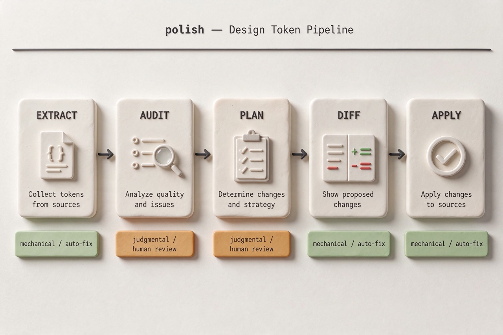
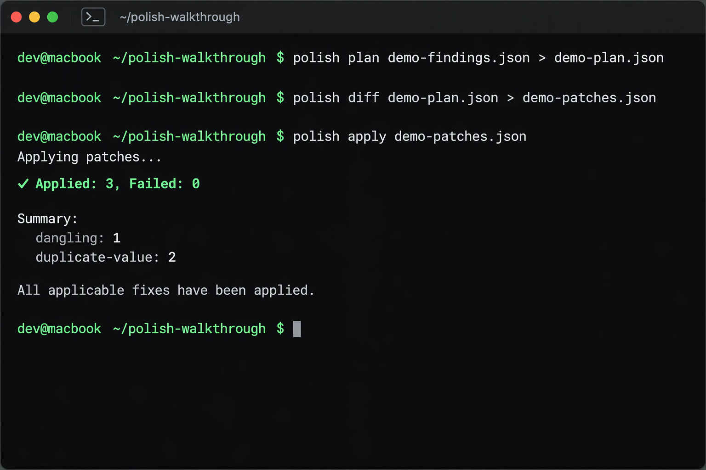

# Walkthrough — Full Pipeline on a Real Project

This directory is a complete, runnable example of the polish pipeline: **extract → critique → plan → diff → apply**.

It uses a small demo project (`demo-project/`) with deliberately planted token issues. Every file here was produced by actually running the pipeline against that project — no hand-written mocks.



## What's Here

```
walkthrough/
├── README.md              ← this file
├── demo-findings.json     ← real output from polish audit
├── demo-plan.json         ← real output from polish plan
├── demo-patches.json      ← real output from polish diff
└── demo-project/
    └── src/
        └── tokens.css     ← the source file being audited (with known issues)
```

## The Demo Project

[`demo-project/src/tokens.css`](demo-project/src/tokens.css) is a 30-line CSS file with five types of token problems:

| Problem | Where | What's wrong |
|---------|-------|--------------|
| **conflict** | `:root` (two blocks) | `--card` has two different values: `#16213e` and `#1f2937` |
| **dangling** | `.button` | `var(--btn-bg)` references a token that's never declared |
| **duplicate-value** | `:root` | `#1a1a2e` declared as `--bg`, `--background`, `--nm-bg`; `#e05800` as `--accent`, `--gold` |
| **orphan** | `:root` | `--bg`, `--background`, `--nm-bg`, `--gold` etc. are declared but never referenced |
| **namespace** | `:root` | Six naming families coexist: `--bg*`, `--background*`, `--nm-*`, `--accent*`, `--gold*`, `--card*` |

## Step 1 — Audit

Point `polish_audit` at the project directory. It scans every CSS/SCSS/HTML/JS file and cross-references tokens.

**MCP tool call:**

```json
{
  "name": "polish_audit",
  "arguments": {
    "target": "examples/walkthrough/demo-project"
  }
}
```

**Node.js API:**

```javascript
import { audit } from 'polish-design-tokens';
const report = audit('./examples/walkthrough/demo-project');
// report.findings → the findings array
```

**Result** — a full report object with 5 findings (see [`demo-findings.json`](demo-findings.json)):

```json
{
  "version": 1,
  "target": { "kind": "path", "value": "demo-project" },
  "summary": {
    "declarations": 7,
    "uniqueTokens": 6,
    "runtimeVariables": 0,
    "runtimeDocuments": 0,
    "findings": 5,
    "bySeverity": { "error": 2, "warn": 2, "info": 1 }
  },
  "findings": [
    {
      "id": "conflict",
      "severity": "error",
      "title": "--card has 2 different values within the root scope",
      "detail": "#16213e (1 occurrences, e.g. src/tokens.css:15); #1f2937 (1 occurrences, e.g. src/tokens.css:20)",
      "evidence": [
        { "file": "src/tokens.css", "line": 15, "scope": "root", "selector": ":root", "themes": [] },
        { "file": "src/tokens.css", "line": 20, "scope": "root", "selector": ":root", "themes": [] }
      ],
      "suggestion": "The root scope should have a single canonical value — merge and reference it everywhere else."
    },
    {
      "id": "dangling",
      "severity": "error",
      "title": "btn-* family has 1 dangling references (100% of all 1)",
      "detail": "The entire naming family is referenced but never declared — this is a systematic gap in the generator, not 1 independent bugs. The most likely cause is that the component library's page-level styles are generated on demand but output incompletely.",
      "evidence": [
        { "name": "--btn-bg", "count": 1, "file": "src/tokens.css", "line": 29 }
      ],
      "suggestion": "Investigate the btn-* generator configuration and re-export page styles. The remaining 0 non-btn-* dangling references are listed below.",
      "refCount": 1
    },
    {
      "id": "duplicate-value",
      "severity": "warn",
      "title": "2 color values are expressed by multiple token names",
      "detail": "#1a1a2e = --bg = --background = --nm-bg；#e05800 = --accent = --gold",
      "evidence": [
        {
          "value": "#1a1a2e",
          "names": ["--bg", "--background", "--nm-bg"],
          "primary": "--bg",
          "secondary": "--background",
          "primaryFile": "src/tokens.css",
          "primaryLine": 6,
          "secondaryFile": "src/tokens.css",
          "secondaryLine": 7
        },
        {
          "value": "#1a1a2e",
          "names": ["--bg", "--background", "--nm-bg"],
          "primary": "--bg",
          "secondary": "--nm-bg",
          "primaryFile": "src/tokens.css",
          "primaryLine": 6,
          "secondaryFile": "src/tokens.css",
          "secondaryLine": 8
        },
        {
          "value": "#e05800",
          "names": ["--accent", "--gold"],
          "primary": "--accent",
          "secondary": "--gold",
          "primaryFile": "src/tokens.css",
          "primaryLine": 11,
          "secondaryFile": "src/tokens.css",
          "secondaryLine": 12
        }
      ],
      "suggestion": "Keep one canonical name per color and alias the rest to it, reducing guesswork about which one to use."
    },
    {
      "id": "orphan",
      "severity": "warn",
      "title": "4 tokens are declared but never referenced",
      "detail": "Distribution by scope: root: 4. A common cause is a shared stylesheet being replaced by another page's variable system.",
      "evidence": [
        { "name": "--bg", "declarations": 1, "scopes": ["root"], "file": "src/tokens.css", "line": 6 },
        { "name": "--background", "declarations": 1, "scopes": ["root"], "file": "src/tokens.css", "line": 7 },
        { "name": "--nm-bg", "declarations": 1, "scopes": ["root"], "file": "src/tokens.css", "line": 8 },
        { "name": "--gold", "declarations": 1, "scopes": ["root"], "file": "src/tokens.css", "line": 12 }
      ],
      "suggestion": "Review each one: delete it, or have the real consumer reference it."
    },
    {
      "id": "namespace",
      "severity": "info",
      "title": "6 naming families coexist",
      "detail": "--bg-*（1），--background-*（1），--nm-*（1），--accent-*（1），--gold-*（1），--card-*（1）",
      "evidence": [
        { "family": "bg", "tokens": ["--bg"], "count": 1, "file": "src/tokens.css", "line": 6 },
        { "family": "background", "tokens": ["--background"], "count": 1, "file": "src/tokens.css", "line": 7 },
        { "family": "nm", "tokens": ["--nm-bg"], "count": 1, "file": "src/tokens.css", "line": 8 },
        { "family": "accent", "tokens": ["--accent"], "count": 1, "file": "src/tokens.css", "line": 11 },
        { "family": "gold", "tokens": ["--gold"], "count": 1, "file": "src/tokens.css", "line": 12 },
        { "family": "card", "tokens": ["--card"], "count": 1, "file": "src/tokens.css", "line": 15 }
      ],
      "suggestion": "Choose one or two naming families as the primary system, and demote the rest to aliases or phase them out."
    }
  ]
}
```

**Key thing to notice**: each finding carries `evidence` with exact `file` and `line` — you can jump straight to the source.

## Step 2 — Plan

Pass the report (or just its `findings` array) to `polish_plan`. It classifies each finding and ranks by priority.

**MCP tool call:**

```json
{
  "name": "polish_plan",
  "arguments": {
    "findings": [ /* the findings array from step 1 */ ]
  }
}
```

**CLI:**

```bash
polish plan demo-findings.json > demo-plan.json
```

**Result** — 5 actions, split into mechanical and judgmental (see [`demo-plan.json`](demo-plan.json)):

| Priority | Finding | Classification | Will auto-fix? |
|----------|---------|----------------|---------------|
| 1 | `conflict` | Judgmental | No — need to pick a canonical value |
| 2 | `dangling` | Judgmental | No — need to decide whether to declare the token or remove the reference |
| 4 | `orphan` | Judgmental | No — need to decide delete or keep |
| 5 | `duplicate-value` | Mechanical | Yes — alias secondary to primary |
| 6 | `namespace` | Judgmental | No — need to unify naming families |

**What this means**: only 1 finding (`duplicate-value`) is mechanical and will get patches. The other 4 are surfaced for human review — the tool won't touch them automatically.

## Step 3 — Diff

Pass the plan to `polish_diff`. It generates concrete patches for mechanical items only.

**MCP tool call:**

```json
{
  "name": "polish_diff",
  "arguments": {
    "plan": [ /* the plan array from step 2 */ ],
    "target": "examples/walkthrough/demo-project"
  }
}
```

**CLI:**

```bash
polish diff demo-plan.json > demo-patches.json
```

**Result** — 3 patches (see [`demo-patches.json`](demo-patches.json)):

```json
[
  {
    "type": "replace",
    "file": "src/tokens.css",
    "line": 7,
    "before": "#1a1a2e",
    "after": "var(--bg)",
    "reason": "--background → alias --bg（#1a1a2e）",
    "findingId": "duplicate-value"
  },
  {
    "type": "replace",
    "file": "src/tokens.css",
    "line": 8,
    "before": "#1a1a2e",
    "after": "var(--bg)",
    "reason": "--nm-bg → alias --bg（#1a1a2e）",
    "findingId": "duplicate-value"
  },
  {
    "type": "replace",
    "file": "src/tokens.css",
    "line": 12,
    "before": "#e05800",
    "after": "var(--accent)",
    "reason": "--gold → alias --accent（#e05800）",
    "findingId": "duplicate-value"
  }
]
```

**What each patch does:**

1. **`replace`** — changes `--background: #1a1a2e;` to `--background: var(--bg);`, aliasing the secondary token to the primary
2. **`replace`** — changes `--nm-bg: #1a1a2e;` to `--nm-bg: var(--bg);`, same pattern
3. **`replace`** — changes `--gold: #e05800;` to `--gold: var(--accent);`, same pattern

Note that `duplicate-value` patches always target the **secondary** token (the one being aliased), never the primary. This prevents self-referencing aliases.

## Step 4 — Apply

Pass the patches to `polish_apply`. Each file is backed up before modification.

**MCP tool call:**

```json
{
  "name": "polish_apply",
  "arguments": {
    "patches": [ /* the patches array from step 3 */ ],
    "target": "examples/walkthrough/demo-project"
  }
}
```

**CLI:**

```bash
polish apply demo-patches.json --target=examples/walkthrough/demo-project
```

**Result** — `src/tokens.css` is modified. A backup `src/tokens.css.backup` is created automatically.

**Before:**

```css
:root {
  --bg: #1a1a2e;
  --background: #1a1a2e;       /* ← patch: #1a1a2e → var(--bg) */
  --nm-bg: #1a1a2e;            /* ← patch: #1a1a2e → var(--bg) */

  --accent: #e05800;
  --gold: #e05800;             /* ← patch: #e05800 → var(--accent) */

  --card: #16213e;
}
```

**After:**

```css
:root {
  --bg: #1a1a2e;
  --background: var(--bg);
  --nm-bg: var(--bg);

  --accent: #e05800;
  --gold: var(--accent);

  --card: #16213e;
}
```

**What was NOT fixed** (needs human decision):
- `dangling` — `--btn-bg` is still referenced by `.button` without a declaration. Decide whether to declare it with a canonical value or remove the reference.
- `--card` conflict — still has two values. You need to pick which one is canonical.
- `orphan` tokens — `--bg`, `--background`, `--nm-bg`, `--gold` etc. are still declared but unused. Decide whether to delete or wire them up.
- `namespace` — six naming families still coexist. Decide on a unified naming convention.

## Running It Yourself



```bash
# 1. Install
npm install -g polish-design-tokens

# 2. Audit the demo project (via MCP or Node API — see README)
#    The output is demo-findings.json (a full report object)

# 3. Plan
polish plan demo-findings.json > demo-plan.json

# 4. Diff
polish diff demo-plan.json > demo-patches.json

# 5. Apply (creates .backup files; --target bounds the patch paths)
cd demo-project
polish apply ../demo-patches.json --target=.

# 6. Verify
cat src/tokens.css        # see the changes
cat src/tokens.css.backup  # see the original
```

Or in one shot with the Node API:

```javascript
import { runPipeline, apply } from 'polish-design-tokens';

const { findings, plan, patches } = runPipeline('./demo-project');
console.log(`${findings.length} findings, ${patches.length} patches`);

const result = await apply(patches, './demo-project');
console.log(`Applied: ${result.applied.length}, Failed: ${result.failed.length}, Status: ${result.status}`);
```

## What the AI Agent Workflow Looks Like

When someone gives an AI agent the GitHub repo URL and asks it to set up polish, the agent typically does:

1. **Clone or install** — `git clone https://github.com/maxdeng007/polish-design-tokens.git` or `npm install -g polish-design-tokens`
2. **Register MCP** — add `polish mcp` to the MCP config
3. **Audit** — call `polish_audit` with the target project path
4. **Plan + Diff + Apply** — chain the three mechanical tools
5. **Report** — summarize what was auto-fixed and what needs human review

This walkthrough mirrors exactly what the agent would do — the JSON files here are the real intermediate outputs, so the agent (or a human) can inspect, modify, or re-run any step.
