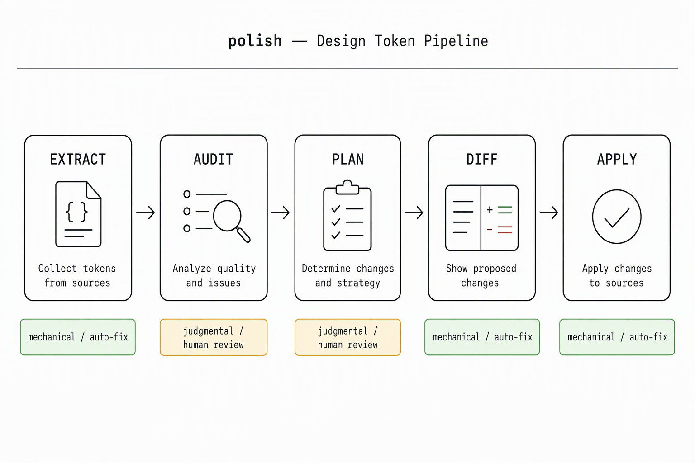
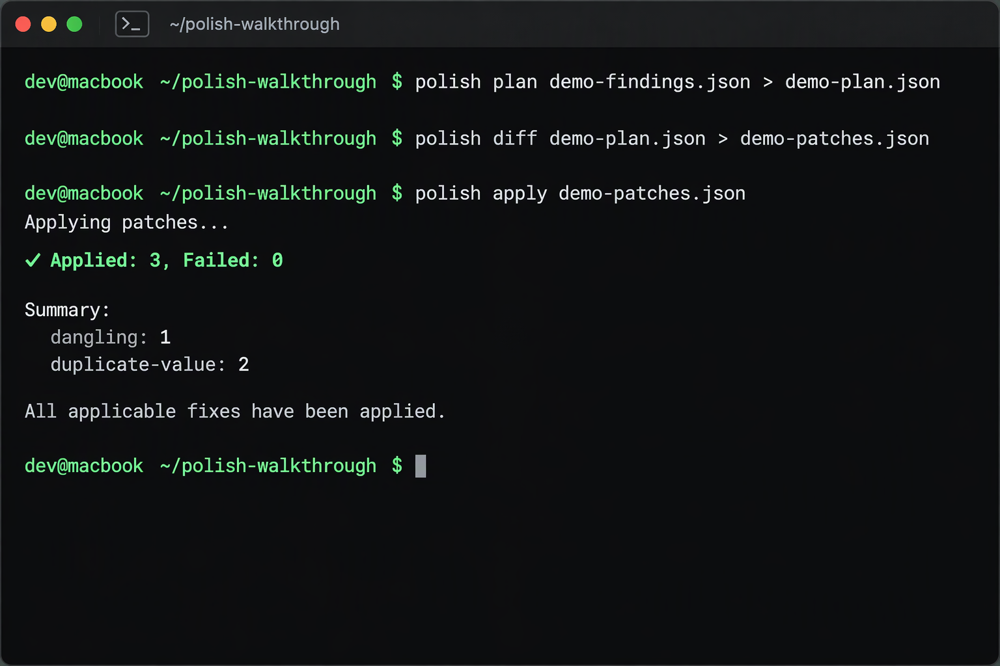

# Walkthrough — Full Pipeline on a Real Project

This directory is a complete, runnable example of the polish pipeline: **extract → critique → plan → diff → apply**.

It uses a small demo project (`demo-project/`) with deliberately planted token issues. Every file here was produced by actually running the pipeline against that project — no hand-written mocks.



## What's Here

```
walkthrough/
├── README.md              ← this file
├── demo-findings.json     ← real output from polish_audit
├── demo-plan.json         ← real output from polish_plan
├── demo-patches.json      ← real output from polish_diff
└── demo-project/
    └── src/
        └── tokens.css     ← the source file being audited (with known issues)
```

## The Demo Project

[`demo-project/src/tokens.css`](demo-project/src/tokens.css) is a 30-line CSS file with five types of token problems:

| Problem | Where | What's wrong |
|---------|-------|--------------|
| **conflict** | `:root` (two blocks) | `--card` has two different values: `#16213e` and `#1f2937` |
| **dangling** | `.button` | `var(--btn-bg)` references a token that's never declared |
| **duplicate-value** | `:root` | `#1a1a2e` declared as `--bg`, `--background`, `--nm-bg`; `#e05800` as `--accent`, `--gold` |
| **orphan** | `:root` | `--nm-bg`, `--gold`, `--nm-bg` etc. are declared but never referenced |
| **namespace** | `:root` | Six naming families coexist: `--bg*`, `--background*`, `--nm-*`, `--accent*`, `--gold*`, `--card*` |

## Step 1 — Audit

Point `polish_audit` at the project directory. It scans every CSS/SCSS/HTML/JS file and cross-references tokens.

**MCP tool call:**

```json
{
  "name": "polish_audit",
  "arguments": {
    "target": "examples/walkthrough/demo-project"
  }
}
```

**Node.js API:**

```javascript
import { audit } from 'polish-design-tokens';
const report = audit('./examples/walkthrough/demo-project');
// report.findings → the findings array
```

**Result** — 5 findings (see [`demo-findings.json`](demo-findings.json)):

```json
[
  {
    "id": "conflict",
    "severity": "error",
    "title": "--card 在 root 作用域内有 2 个不同的值",
    "detail": "#16213e（1 处，如 src/tokens.css:14）；#1f2937（1 处，如 src/tokens.css:20）",
    "evidence": [
      { "file": "src/tokens.css", "line": 14, "scope": "root", "selector": ":root" },
      { "file": "src/tokens.css", "line": 20, "scope": "root", "selector": ":root" }
    ],
    "suggestion": "根作用域应只有一个真值——合并后其余位置改为引用。"
  },
  {
    "id": "dangling",
    "severity": "error",
    "title": "btn-* 家族有 1 个悬空引用（占全部 1 个的 100%）",
    "detail": "整个命名族被引用却从未声明——这是生成端的系统性缺口，不是 1 个独立 bug。",
    "evidence": [
      { "name": "--btn-bg", "count": 1, "file": "src/tokens.css", "line": 29 }
    ],
    "suggestion": "排查 btn-* 的生成器配置，重新导出页面样式。"
  },
  {
    "id": "duplicate-value",
    "severity": "warn",
    "title": "2 组颜色被多个令牌名重复表达",
    "detail": "#1a1a2e = --bg = --background = --nm-bg；#e05800 = --accent = --gold",
    "evidence": [
      {
        "value": "#1a1a2e",
        "names": ["--bg", "--background", "--nm-bg"],
        "primary": "--bg",
        "secondary": "--background",
        "primaryFile": "src/tokens.css",
        "primaryLine": 6,
        "secondaryFile": "src/tokens.css",
        "secondaryLine": 7
      },
      {
        "value": "#e05800",
        "names": ["--accent", "--gold"],
        "primary": "--accent",
        "secondary": "--gold",
        "primaryFile": "src/tokens.css",
        "primaryLine": 11,
        "secondaryFile": "src/tokens.css",
        "secondaryLine": 12
      }
    ],
    "suggestion": "同一颜色保留一个主名，其余改成别名引用，减少\"该用哪个\"的猜测。"
  },
  {
    "id": "orphan",
    "severity": "warn",
    "title": "4 个令牌声明了却从未被引用",
    "detail": "按作用域分布：root 4 个。典型来源是共享样式表被另一个页面的变量体系取代了。",
    "evidence": [
      { "name": "--nm-bg", "declarations": 1, "scopes": ["root"] },
      { "name": "--gold", "declarations": 1, "scopes": ["root"] }
    ],
    "suggestion": "逐个确认：删掉，或让真正的消费方引用它。"
  },
  {
    "id": "namespace",
    "severity": "info",
    "title": "并存 6 个命名族",
    "detail": "--bg-*（1），--background-*（1），--nm-*（1），--accent-*（1），--gold-*（1），--card-*（1）",
    "suggestion": "选定一到两个命名族作为主体系，其余降级为别名或逐步废弃。"
  }
]
```

**Key thing to notice**: each finding carries `evidence` with exact `file` and `line` — you can jump straight to the source.

## Step 2 — Plan

Pass the findings array to `polish_plan`. It classifies each finding and ranks by priority.

**MCP tool call:**

```json
{
  "name": "polish_plan",
  "arguments": {
    "findings": [ /* the findings array from step 1 */ ]
  }
}
```

**CLI:**

```bash
polish plan demo-findings.json > demo-plan.json
```

**Result** — 5 actions, split into mechanical and judgmental (see [`demo-plan.json`](demo-plan.json)):

| Priority | Finding | Classification | Will auto-fix? |
|----------|---------|----------------|---------------|
| 1 | `conflict` | Judgmental | No — need to pick a canonical value |
| 2 | `dangling` | Mechanical | Yes — add a declaration |
| 4 | `orphan` | Judgmental | No — need to decide delete or keep |
| 5 | `duplicate-value` | Mechanical | Yes — alias secondary to primary |
| 6 | `namespace` | Judgmental | No — need to unify naming families |

**What this means**: 2 findings (`dangling`, `duplicate-value`) are mechanical and will get patches. The other 3 are surfaced for human review — the tool won't touch them automatically.

## Step 3 — Diff

Pass the plan to `polish_diff`. It generates concrete patches for mechanical items only.

**MCP tool call:**

```json
{
  "name": "polish_diff",
  "arguments": {
    "plan": [ /* the plan array from step 2 */ ],
    "target": "examples/walkthrough/demo-project"
  }
}
```

**CLI:**

```bash
polish diff demo-plan.json > demo-patches.json
```

**Result** — 3 patches (see [`demo-patches.json`](demo-patches.json)):

```json
[
  {
    "type": "add",
    "file": "src/tokens.css",
    "line": 29,
    "before": "",
    "after": "--btn-bg: var(--token-default);",
    "reason": "btn-* 家族有 1 个悬空引用（占全部 1 个的 100%）",
    "findingId": "dangling"
  },
  {
    "type": "replace",
    "file": "src/tokens.css",
    "line": 7,
    "before": "#1a1a2e",
    "after": "var(--bg)",
    "reason": "--background → alias --bg（#1a1a2e）",
    "findingId": "duplicate-value"
  },
  {
    "type": "replace",
    "file": "src/tokens.css",
    "line": 12,
    "before": "#e05800",
    "after": "var(--accent)",
    "reason": "--gold → alias --accent（#e05800）",
    "findingId": "duplicate-value"
  }
]
```

**What each patch does:**

1. **`add`** — inserts `--btn-bg: var(--token-default);` at line 29, fixing the dangling reference by providing a declaration
2. **`replace`** — changes `--background: #1a1a2e;` to `--background: var(--bg);`, aliasing the secondary token to the primary
3. **`replace`** — changes `--gold: #e05800;` to `--gold: var(--accent);`, same pattern

Note that `duplicate-value` patches always target the **secondary** token (the one being aliased), never the primary. This prevents self-referencing aliases.

## Step 4 — Apply

Pass the patches to `polish_apply`. Each file is backed up before modification.

**MCP tool call:**

```json
{
  "name": "polish_apply",
  "arguments": {
    "patches": [ /* the patches array from step 3 */ ],
    "target": "examples/walkthrough/demo-project"
  }
}
```

**CLI:**

```bash
polish apply demo-patches.json
```

**Result** — `src/tokens.css` is modified. A backup `src/tokens.css.backup` is created automatically.

**Before:**

```css
:root {
  --bg: #1a1a2e;
  --background: #1a1a2e;       /* ← patch: #1a1a2e → var(--bg) */
  --nm-bg: #1a1a2e;

  --accent: #e05800;
  --gold: #e05800;             /* ← patch: #e05800 → var(--accent) */

  --card: #16213e;
}
```

**After:**

```css
:root {
  --bg: #1a1a2e;
  --background: var(--bg);
  --nm-bg: #1a1a2e;

  --accent: #e05800;
  --gold: var(--accent);

  --card: #16213e;
}
```

And at line 29, the dangling reference gets a declaration:

```css
.button {
  background-color: var(--btn-bg);
}

/* ← patch: added --btn-bg: var(--token-default); */
```

**What was NOT fixed** (needs human decision):
- `--card` conflict — still has two values. You need to pick which one is canonical.
- `orphan` tokens — `--nm-bg`, `--gold` etc. are still declared but unused. Decide whether to delete or wire them up.
- `namespace` — six naming families still coexist. Decide on a unified naming convention.

## Running It Yourself



```bash
# 1. Install
npm install -g polish-design-tokens

# 2. Audit the demo project (via MCP or Node API — see README)
#    The output is demo-findings.json

# 3. Plan
polish plan demo-findings.json > demo-plan.json

# 4. Diff
polish diff demo-plan.json > demo-patches.json

# 5. Apply (creates .backup files)
cd demo-project
polish apply ../demo-patches.json

# 6. Verify
cat src/tokens.css        # see the changes
cat src/tokens.css.backup  # see the original
```

Or in one shot with the Node API:

```javascript
import { runPipeline, apply } from 'polish-design-tokens';

const { findings, plan, patches } = runPipeline('./demo-project');
console.log(`${findings.length} findings, ${patches.length} patches`);

const result = await apply(patches);
console.log(`Applied: ${result.applied.length}, Failed: ${result.failed.length}`);
```

## What the AI Agent Workflow Looks Like

When someone gives an AI agent the GitHub repo URL and asks it to set up polish, the agent typically does:

1. **Clone or install** — `git clone https://github.com/maxdeng007/polish-design-tokens.git` or `npm install -g polish-design-tokens`
2. **Register MCP** — add `polish mcp` to the MCP config
3. **Audit** — call `polish_audit` with the target project path
4. **Plan + Diff + Apply** — chain the three mechanical tools
5. **Report** — summarize what was auto-fixed and what needs human review

This walkthrough mirrors exactly what the agent would do — the JSON files here are the real intermediate outputs, so the agent (or a human) can inspect, modify, or re-run any step.
