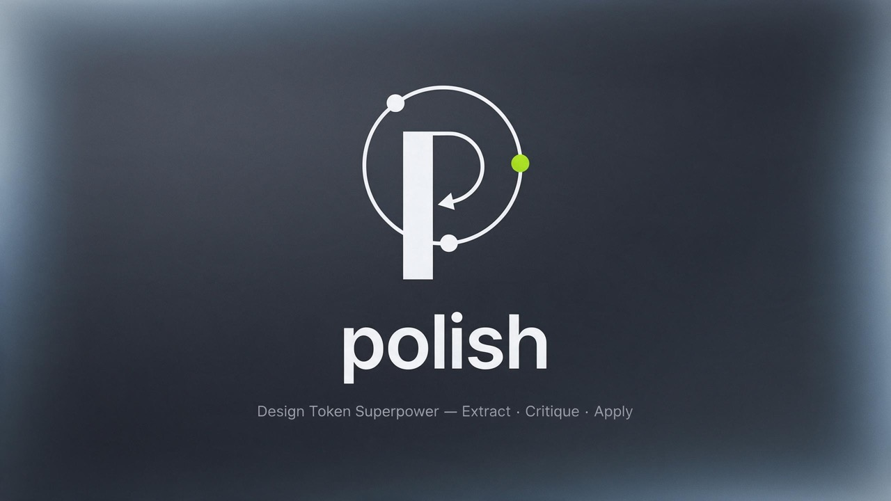
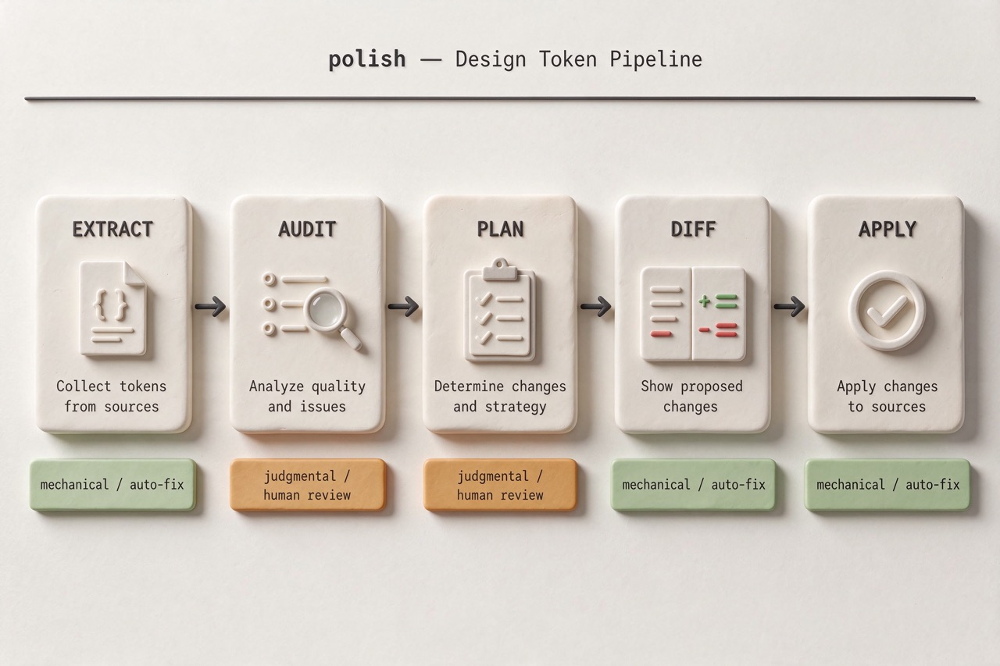

[English](README.md) | [中文](README.zh-CN.md)

# polish — Design Token Superpower Tool

**Extract · Critique · Apply** — a zero-dependency toolkit that closes the loop on CSS custom properties (design tokens). It scans stylesheets for token problems, classifies each finding, and auto-applies mechanical fixes while flagging judgmental ones for human decisions.

Works as a CLI, an MCP server for AI coding agents, or a Node.js module.

**Built for** frontend engineers and design-system maintainers who use CSS custom properties and need to keep them consistent as a project grows.

**Repository**: [https://github.com/maxdeng007/polish-design-tokens](https://github.com/maxdeng007/polish-design-tokens)



## Problem

Design tokens — CSS custom properties like `--color-primary` — are powerful but fragile. As projects grow, tokens drift: hardcoded colors creep in, duplicate values appear under different names, references dangle, and cascade overrides silently break consistency. Detecting these issues manually is tedious; fixing them is even more so.

**polish** automates the audit → fix pipeline:

1. **Extract** — scan CSS/HTML files, build a declaration graph
2. **Critique** — cross-reference declarations and references to find problems
3. **Apply** — generate and execute patches for mechanical fixes, with backups

**Important scope note:** of the 13 finding types polish detects, only `duplicate-value` is auto-fixed. The remaining 12 are flagged for human or agent review — polish tells you what's wrong, but the decision on how to fix it is yours.

## Why Not Stylelint or ESLint?

Stylelint and ESLint catch syntax errors and style-rule violations, but they don't understand token relationships. They can't tell you that `--background` duplicates `--bg`, or that a token you're referencing was never declared. polish builds a declaration graph and cross-references it to find exactly these structural token problems — then auto-fixes the mechanical ones and flags the rest for your judgment.

The mechanical/judgmental split is the core idea: problems with one safe answer are fixed automatically; problems that need a decision are surfaced, never silently patched.

## Installation

**From npm** (recommended):

```bash
npm install -g polish-design-tokens
```

Or as a project dependency:

```bash
npm install polish-design-tokens --save-dev
```

**From GitHub** (if you want the latest source):

```bash
git clone https://github.com/maxdeng007/polish-design-tokens.git
cd polish-design-tokens/polish-mono
npm install -g .
```

Requires Node.js ≥ 18.

## Install via AI (No Coding Required)

**For non-technical users.** If you're not comfortable with the command line above, you can skip it entirely. Copy the prompt below, paste it into any AI chat (ChatGPT, Claude, etc.), and the AI will install polish and audit your project for you — no coding required.

```text
Please help me audit the design tokens in my project using the "polish" tool.

1. Install the polish tool globally by running:
   npm install -g polish-design-tokens

2. Run an audit on my project directory at:
   [PASTE YOUR PROJECT PATH HERE]

3. Report what you find in plain language a designer can understand:
   - What token problems exist (hardcoded colors, duplicate values,
     dangling references, conflicts, etc.)
   - Which issues can be auto-fixed and which need my decision
   - A clear summary — not raw JSON

Do NOT apply any fixes or modify any files. Install, audit, and report only.
```

**What's next:** polish stays installed on your system after the audit — no reinstall needed. If you want to apply the mechanical fixes (duplicate values), just give your AI a follow-up prompt like: *"Now apply the mechanical fixes to my project with backups."* The AI will re-run the audit, generate patches, and apply them with automatic backups.

## Optional Skills

polish works out of the box with zero dependencies. Four optional skills and tools enhance the experience — none are required for token auditing. Run `polish doctor` to check what's installed; it reports any missing skill with a ready-to-run install command. Pass `--install` to `polish doctor` to auto-install missing ones.

| Skill / Tool | What It Does | How It Complements polish |
|---|---|---|
| `awesome-design-md` | 54 ready-to-use DESIGN.md files from brands like Vercel, Stripe, Linear, and Notion | Powers `polish_style_lookup` — query a brand's design tokens (colors, typography, spacing) for a specific visual language |
| `dembrandt` | Design token analysis and classification tool | Complementary token tool — polish audits your project; dembrandt helps classify and normalize token data |
| `taste` | Frontend art direction and design taste | Informs design decisions when polish flags judgmental findings (hardcoded colors, naming conflicts, cascade overrides) |
| `impeccable` | Production-grade frontend interface generation | Builds polished UI that uses your tokens consistently, working alongside polish's audit-and-fix pipeline |

All four are optional. polish performs a complete token audit without any of them — install the ones that match your workflow.

## Quick Start

**For CLI users.** The standard four-step pipeline:

```bash
# 1. Audit a project for token issues
polish audit ./my-project --ignore=node_modules,dist > findings.json

# 2. Convert findings to a ranked plan
polish plan findings.json > plan.json

# 3. Generate mechanical patches
polish diff plan.json > patches.json

# 4. Apply patches (creates .backup files automatically)
polish apply patches.json --target=./my-project
```

**Or just run `polish` with no arguments** to launch the interactive wizard — it walks you through all five steps with confirmation prompts, no JSON files or command flags to remember. See [Interactive Wizard](#interactive-wizard) below.

**One-shot commands.** For quick, repeatable use without chaining JSON files:

```bash
# Read-only health check — exit code 1 if errors found, ready for CI
polish check ./my-project

# One-shot fix — scans, applies mechanical patches with backup, reports the rest
polish fix ./my-project

# Preview fixes without touching files
polish fix ./my-project --dry-run

# Generate an interactive HTML report — open in any browser, check decisions
polish report ./my-project
```

`polish check` never modifies files — it's safe to run in CI, pre-commit hooks, or any time you want a quick token health snapshot. `polish fix` collapses the full audit → plan → diff → apply pipeline into a single command, applying only mechanical fixes and flagging judgmental issues for your review. `polish report` produces a self-contained HTML file you can share with designers — it color-codes findings by severity and includes checkboxes for simple decisions (delete an orphan token, alias a duplicate value); check them and download a `decisions.json` to feed into `polish confirm`.

## AI Agent Deployment

**For AI coding agents.** The most common workflow: give your AI coding agent (Qoder, Claude, etc.) the GitHub repo URL and ask it to set up and run polish. The agent will:

1. Clone the repo or install from npm
2. Register the MCP server (see below)
3. Use `polish_audit` to scan the target project
4. Use `polish_plan` → `polish_diff` → `polish_apply` to fix mechanical issues

All `polish apply` operations create `.backup` files before modifying any file. Failed patches are recorded and do not abort the batch — review the apply report for failures.

## The Pipeline

polish operates in three phases. Each phase reads the output of the previous one, so you can run the full chain or stop at any point.

```
findings.json → [polish plan] → plan.json → [polish diff] → patches.json → [polish apply] → files
```

### 1. Plan — classify and rank

Takes findings (from `polish_audit`) and produces an ordered action queue. Each finding is classified as:

- **Mechanical** — safe to auto-fix. No human decision needed.
- **Judgmental** — requires human judgment. Surfaced for manual review.

Findings are ranked by priority:

| Priority | Type | Description | Classification |
|----------|------|-------------|----------------|
| 1 | `conflict` | Same token name with different values in root scope | Judgmental |
| 2 | `dangling` | Token referenced but never declared | Judgmental |
| 3 | `runtime-drift` | Inconsistent token values across pages at runtime | Judgmental |
| 4 | `orphan` | Declared but never referenced | Judgmental |
| 5 | `duplicate-value` | Multiple token names sharing the same value | Mechanical |
| 6 | `namespace` | Multiple naming families coexist | Judgmental |
| 7 | `hardcoded` | Raw color/space values used instead of token references | Judgmental |
| 8 | `cascade-override` | CSS cascading produces unintended variation | Judgmental |
| 9 | `state-variation` | Token values differ across component states | Judgmental |
| 10 | `theme-variation` | Token values differ across themes | Judgmental |
| 11 | `dynamic-variable` | Tokens with dynamic (non-static) values | Judgmental |
| 12 | `tailwind-utility-var` | Tailwind v4 per-utility variables | Judgmental |

Only **mechanical** findings (`duplicate-value`) produce patches in the next phase.

### 2. Diff — generate patches

Reads the plan and generates concrete patches for mechanical items only. Each patch specifies:

- **type**: `replace` (before → after), `add` (insert new declaration), `rename`, or `rewrite`
- **file** / **line**: exact location
- **before** / **after**: the exact text change
- **reason**: human-readable explanation

Patches for `duplicate-value` target the **secondary** token's location and alias it to the primary — never the primary itself (preventing self-referencing aliases).

### 3. Apply — execute with backup

Applies patches to files with automatic backup protection. Each file is backed up before modification. The result reports what was applied and any failures.

## Input

polish reads **local files** — it does not fetch from URLs or online resources.

Provide a **directory path** (recommended) or a **single file path** as the `target`. When given a directory, polish recursively scans every supported file inside it, automatically skipping common build and dependency directories (`node_modules`, `dist`, `.git`, etc.) and binary files.

The same `target` parameter is used across all three entry points — CLI, MCP, and Node.js API.

## CLI Usage

```bash
polish                                 # Launch the interactive wizard
polish wizard [--target=dir] [--ignore=a,b]  # Guided pipeline with confirmation prompts
polish audit  <target> [--ignore=a,b] [--summary]  # Scan and output findings
polish check  <target> [--ignore=a,b]              # Health check: read-only summary, exit code = errors
polish fix    <target> [--ignore=a,b] [--dry-run]  # One-shot fix: apply mechanical patches with backup
polish report <target> [--ignore=a,b] [--output=f] # Generate interactive HTML report
polish plan  <findings.json> [--summary]   # Convert findings to an ordered action list
polish diff  <plan.json> [--summary]       # Generate mechanical patches from a plan
polish apply <patches.json> [--summary]    # Apply patches (creates .backup files)
polish rollback <backups.json> [--target=dir] [--summary]  # Restore files from an apply run backup manifest
polish confirm <decisions.json> [--target=dir] [--summary]  # Apply designer-confirmed judgmental decisions
polish seed  <target> [--output=dir] [--force] [--summary]   # Generate a draft tokens.css + tokens.seed.json from literal clusters
polish doctor [--install] [--summary]      # Check optional deps; --install auto-installs missing ones
polish explain <finding-type>              # Explain what a finding type means and how to fix it
polish mcp                       # Start MCP server (JSON-RPC over stdin/stdout)
```

**`--summary`** prints a human-readable summary instead of raw JSON — ideal when reading results in a terminal. Works for all commands:

```bash
polish audit ./my-project --summary
# Token Audit Summary
# ...
# Found 130 issues:
#   [Judgmental] 10 conflict
#   [Mechanical] 34 duplicate-value
# ...
```

When output goes to a terminal, findings are **color-coded by severity** — red for errors, yellow for warnings, green for informational. Colors are automatically disabled when output is piped or redirected.

**`--install`** (doctor only) automatically installs missing optional dependencies. Without it, doctor just reports what's missing and shows the install commands to run manually:

```bash
polish doctor              # Check what's installed, show install commands for missing
polish doctor --install    # Check and auto-install missing optional dependencies
```

**`polish explain`** prints a plain-language explanation of any finding type — what it means, why it matters, and how to fix it. Run it when you see a finding type in your report and want to understand it without reading the docs:

```bash
polish explain conflict
polish explain hardcoded
```

**`polish confirm`** applies designer-confirmed decisions for judgmental findings — the ones that `polish diff` cannot auto-fix because they need a human decision. Pass a decisions JSON file and a target directory; polish re-scans the target, resolves each decision into a patch, and applies it with backup protection.

```bash
# decisions.json
{
  "decisions": [
    { "action": "delete", "token": "--primary" },
    { "action": "alias", "from": "--heading", "to": "--text" },
    { "action": "rename", "from": "--bg", "to": "--background" }
  ]
}
```

```bash
polish confirm decisions.json --target=./my-project --summary
```

Three decision actions are supported:

| Action | Effect | Use for |
|--------|--------|---------|
| `delete` | Removes the token declaration | Orphan tokens |
| `alias` | Replaces the value with `var(--to)` | Duplicate values with a chosen primary |
| `rename` | Rewrites all occurrences across files | Namespace fragmentation |

The same decisions can be collected interactively via the wizard's **Confirm** step (Step 3 of 5).

**`polish report`** generates a self-contained, interactive HTML report — open it in any browser to review findings without touching the CLI or JSON. Findings are color-coded by severity and grouped into error/warn/info sections. Each card shows the finding type, file and line, evidence, and a suggestion; color values render with a swatch so you can see the color at a glance. Simple decisions (delete an orphan token, alias a duplicate value) get a checkbox — check the ones you agree with and click **Download** or **Copy decisions.json** to export them. The report shows the exact `polish confirm` command to run next, or you can hand `decisions.json` to an AI agent to apply.

```bash
polish report ./my-project                       # Writes polish-report.html into the target
polish report ./my-project --output=report.html   # Writes to a specific path
polish report ./my-project --ignore=node_modules  # Skip directories
```

The HTML is fully self-contained — no external CSS, JS, or network requests — so you can share it by email, drop it in a repo, or open it offline.

## Interactive Wizard

Running `polish` with no arguments (or `polish wizard`) launches an interactive wizard that walks you through the entire pipeline — audit, plan, confirm, diff, and apply — step by step with confirmation prompts. No JSON files to redirect, no command flags to remember.

```bash
polish
# ▸ Polish — Design Token Superpower Tool
#
# Step 1: Audit
# Project directory to scan [.]: .
# Scanning...
#   Found 130 issues: 10 conflict, 34 duplicate-value, ...
# Proceed to build an action plan? [Y/n/q] y
#
# Step 2: Plan
#   10 judgmental actions (review recommended)
#   34 mechanical actions (auto-fixable)
# Proceed to review decisions and generate patches? [Y/n/q] y
#
# Step 3: Confirm
#   2 judgmental finding(s) need your decision:
#   Delete --primary? [y/N/q] y
#   ✓ will delete --primary
#   1 patch(es) from confirmed decisions
#
# Step 4: Patch
#   Generated 35 patches (34 mechanical + 1 confirmed).
# Apply patches now? [Y/n/q] y
#
#   ✓ 35 patches applied, 0 failed
#   2 backup files created
# Done.
```

At each step you can answer **y** (continue), **n** (skip to the next step), or **q** (quit entirely — no changes are made). You can also pass `--target=dir` and `--ignore=a,b` to skip the initial directory and ignore-pattern prompts.

The wizard never modifies files until you confirm at the apply step. Even then, every modified file is backed up with a `.backup` suffix before any change is written.

Without `--summary`, all commands output raw JSON for piping and programmatic use.

## MCP Server

polish exposes 10 tools via the Model Context Protocol, so any AI coding agent (Qoder, Claude, etc.) can drive the full pipeline.

Add to your MCP config (`mcp.json`, `.mcp.json`, or your agent's config):

```json
{
  "mcpServers": {
    "polish": {
      "command": "polish",
      "args": ["mcp"]
    }
  }
}
```

If `polish` is not on the agent's PATH, use `npx` instead:

```json
{
  "mcpServers": {
    "polish": {
      "command": "npx",
      "args": ["-y", "polish-design-tokens", "mcp"]
    }
  }
}
```

Available tools:

| Tool | Description |
|------|-------------|
| `polish_extract` | Extract token declarations from a directory |
| `polish_audit` | Scan + cross-reference to produce findings |
| `polish_measure` | Normalize runtime observation data for audit |
| `polish_plan` | Convert findings to a ranked, classified action queue |
| `polish_diff` | Generate mechanical patches from a plan |
| `polish_apply` | Execute patches with backup protection and automatic rollback on failure |
| `polish_rollback` | Restore files from an apply run's backup manifest |
| `polish_doctor` | Check optional dependencies and environment health |
| `polish_style_lookup` | Query brand DESIGN.md design token data |
| `polish_seed` | Generate a draft tokens.css + tokens.seed.json from repeated literal values |

## Node.js API

```javascript
import { plan, generateDiffs, apply } from 'polish-design-tokens';
import { extract, audit, runPipeline, measure, runWizard } from 'polish-design-tokens';

// Full pipeline: scan → audit → plan → diff (does NOT apply)
const { graph, findings, plan, patches } = runPipeline('./my-project');

// Interactive wizard (audit → plan → diff → apply with prompts)
const wizardResult = await runWizard({ target: './my-project' });

// Manual step-by-step
const graph = extract('./my-project');
const report = audit('./my-project');
const actions = plan(report.findings);
const patches = generateDiffs(actions);
const result = await apply(patches);
```

### API Reference

| Function | Signature | Description |
|----------|-----------|-------------|
| `extract` | `(target: string, ignore?: string[]) → DeclarationGraph` | Scan a directory for token declarations and references |
| `audit` | `(target: string, ignore?: string[], observation?: RuntimeObservation) → AuditReport` | Scan + cross-reference to produce findings |
| `runPipeline` | `(target: string, ignore?: string[], observation?: RuntimeObservation) → PipelineResult` | Full pipeline: extract → audit → plan → diff (no apply) |
| `scan` | `(target: string, ignore?: string[]) → DeclarationGraph` | Low-level scan, same as `extract` |
| `cross` | `(graph: DeclarationGraph, observation?: RuntimeObservation) → AuditReport` | Judge findings from a declaration graph |
| `measure` | `(docs?: unknown[]) → RuntimeObservation` | Normalize runtime observation data for audit |
| `plan` | `(findings: Finding[]) → PlanAction[]` | Rank and classify findings into an action queue |
| `generateDiffs` | `(planItems: PlanAction[]) → Patch[]` | Generate mechanical patches from a plan |
| `apply` | `(patches: Patch[], target?: string) → Promise<ApplyResult>` | Apply patches with backup protection (target defaults to cwd) |
| `confirm` | `(decisions: Decision[], graph: DeclarationGraph) → Patch[]` | Resolve designer-confirmed decisions into patches |
| `seed` | `(target: string, opts?: { output?: string, force?: boolean }) → SeedResult` | Generate a draft token system (tokens.css + tokens.seed.json) from literal clusters |
| `generateReport` | `(report: AuditReport) → string` | Generate a self-contained interactive HTML report |
| `runWizard` | `(opts?: WizardOptions) → Promise<WizardResult>` | Interactive guided pipeline with confirmation prompts |

TypeScript definitions are bundled — no `@types` package needed. All types are exported from the package root.

### Format Support

polish scans the following file types. Each is parsed for CSS custom property declarations and `var()` references:

| File Type | Extensions | What is Extracted |
|-----------|-----------|-------------------|
| CSS | `.css` | All `--name: value` declarations and `var(--name)` references |
| SCSS / LESS | `.scss`, `.less` | Same as CSS |
| HTML | `.html`, `.htm` | `<style>` blocks, inline `style=""` attributes, `<script>` style objects |
| JavaScript / TypeScript | `.js`, `.ts`, `.jsx`, `.tsx`, `.mjs`, `.cjs` | Inline style objects and `setProperty()` calls; JSX text content is ignored |
| Vue / Svelte | `.vue`, `.svelte` | `<template>` inline styles, `<script>` style objects, `<style>` blocks |

Files inside `node_modules`, `dist`, `build`, `.git`, `.next`, `.cache`, and other common build/dependency directories are automatically skipped. Use the `ignore` option to exclude additional path fragments.

### MCP Integration Details

All 10 MCP tools accept and return JSON. Key parameters:

- **`polish_extract`** — `{ target: string, ignore?: string[] }` → `DeclarationGraph`
- **`polish_audit`** — `{ target: string, ignore?: string[], observation?: object }` → `{ findings, summary, graphSummary, observation }`
- **`polish_measure`** — `{ documents: unknown[] }` → `RuntimeObservation`
- **`polish_plan`** — `{ findings: Finding[] }` → `{ plan, summary }`
- **`polish_diff`** — `{ plan: PlanAction[], target?: string }` → `{ patches, preview }`
- **`polish_apply`** — `{ patches: Patch[], target: string }` → `ApplyResult`
- **`polish_rollback`** — `{ backups: { file, backup }[], target: string }` → `RollbackResult`
- **`polish_doctor`** — `{}` → dependency health check
- **`polish_style_lookup`** — `{ brand?: string }` → brand design token reference
- **`polish_seed`** — `{ target: string, output?: string, force?: boolean }` → `{ tokensCss, seedFile, outputFiles, tokenCount, clusterCount }`

The `polish_style_lookup` tool falls back to bundled brand data (Vercel, Stripe, Linear, Notion, Anthropic, GitHub, shadcn, Figma) when no external skill files are found, making it work on any machine without additional setup.

## Static vs Runtime Analysis

**polish-design-tokens** performs **static analysis** — it scans source files (CSS, SCSS, HTML, JS/TS) to find token declarations, references, and conflicts. This works on any project, any environment, no extra setup required.

**Runtime measurement** (checking actual rendered values in a live browser) is available via the `measure()` function, exported from this package. It detects `runtime-drift` and `hardcoded` findings that only appear when tokens are evaluated in a real browser. This requires Chrome DevTools to be available. A companion MCP package can wrap `measure()` with browser automation if you prefer not to call it directly.

For most use cases — auditing a project's source, fixing mechanical issues, and verifying token consistency — the static pipeline in `polish-design-tokens` is sufficient. Use `measure()` (or a browser-automation companion) when you need to verify what users actually see in the browser.

## What It Finds

**Mechanical (auto-fixable by `polish diff` + `polish apply`):**

- **`duplicate-value`** — Two or more token names share the same value. Fix: make secondary tokens alias the primary.

**Judgmental (flagged for human review, no auto-patch):**

- **`dangling`** — A token is referenced but never declared. Requires supplying a canonical value — auto-inserting `inherit` can produce invalid or broken CSS.
- **`hardcoded`** — Raw color or space values used directly instead of token references. Requires choosing the right token to map to. Detected only with runtime measurement (`measure()`); static scans won't produce it.
- **`conflict`** — Same token name declared with different values. Requires choosing a canonical value.
- **`cascade-override`** — Normal CSS cascading produces unintended value variation. Requires deciding whether to refactor or accept.
- **`namespace`** — Multiple naming conventions coexist (e.g. `--color-*` and `--bg-*`). Requires unifying naming.
- **`orphan`** — Declared but never referenced. Requires deciding to remove or keep.
- **`runtime-drift`** — Token values differ across pages when measured at runtime. Requires investigating the source. Detected only with runtime measurement (`measure()`); static scans won't produce it.
- **`state-variation`** — Token values differ across component states (e.g., `:hover`, `:focus`). Requires deciding whether to split into separate tokens or accept the variation.
- **`theme-variation`** — Token values differ across themes (e.g., dark/light). Requires deciding whether to formalize the theme structure.
- **`dynamic-variable`** — Tokens with dynamic (non-static) values, such as those computed at runtime. Requires deciding how to handle the dynamic behavior.
- **`literal-cluster`** (info / judgmental / priority 13) — The same literal value is used repeatedly across the project — a token candidate.

### Bridge from no tokens

Projects with no existing token system can still adopt polish. `literal-cluster` findings surface repeated literal values (colors, spacing, radii, font sizes) as token candidates. The flow:

1. Run `polish seed <target>` to generate a draft `tokens.css` and an authoritative `tokens.seed.json` (naming map + `tokenize` decisions).
2. Edit the token names in `tokens.seed.json` to match your conventions.
3. Run `polish confirm tokens.seed.json --target=<target>` to replace the literals with `var()` references.

Backups and rollback apply as usual — every `confirm` run is backed up before it writes, and a failed run is rolled back.

## Troubleshooting

**`polish_style_lookup` returns `found: false`**
No external design-md skill files were found, and no brand name was provided. Pass a `brand` parameter (e.g. `"vercel"`, `"stripe"`) to use the bundled brand data, or install the awesome-design-md skill for full coverage.

**`polish apply` reports `before text not found`**
The patch's `before` string doesn't match the file content exactly — whitespace, quotes, or line content may differ. Check the `.backup` file (created before each apply) and regenerate patches from a fresh audit.

**`runtime-drift` findings appear with no observation data**
Runtime findings (`runtime-drift`, `hardcoded`) require a `RuntimeObservation` from `measure()`. Static-only audits won't produce them. Call `measure()` with browser-observed variable data and pass it as the `observation` parameter to `audit()` or `cross()`.

**Large projects scan slowly**
The scanner is zero-dependency and single-threaded. For projects with thousands of files, use the `ignore` option to exclude directories that don't contain tokens. Binary files (detected by null bytes) are skipped automatically.

## Performance Notes

- **Scan** is O(n × m) where n is the number of files and m is the average file size. The parser uses a single-pass state machine for CSS and regex-based extraction for HTML/JS — no AST parsing overhead.
- **Cross** is O(d²) in the worst case for conflict detection, where d is the number of declarations per token name. In practice, most tokens have fewer than 10 declarations, so this is negligible.
- **Apply** reads each file once and writes it once, regardless of how many patches target it. Backups are created once per file.
- The tool has **zero runtime dependencies** — no npm install required at runtime beyond the package itself.

## Why Use It

- **Closes the loop** — extract → critique → apply, no manual patching
- **Safe** — only mechanical fixes are auto-applied; judgmental ones are flagged
- **Backed up** — automatic file backups before any apply
- **Agent-ready** — MCP protocol lets any AI coding agent drive the pipeline
- **Zero dependencies** — pure JavaScript, works anywhere Node.js runs

## Repo Structure

| Directory | Description |
|-----------|-------------|
| `polish-mono/` | Unified npm package for distribution (`polish-design-tokens`) — core tool, CLI, MCP server, tests |
| `examples/` | Sample projects with known token issues |
| `docs/` | Design specs and implementation plans |

## Examples

See [`examples/walkthrough/`](https://github.com/maxdeng007/polish-design-tokens/tree/main/examples/walkthrough/) — a complete, runnable walkthrough of the full pipeline (audit → plan → diff → apply) on a demo project with real pipeline outputs, including a visual flow diagram and terminal screenshots.

Also see [`examples/legacy-token-audit/noah-sample/`](https://github.com/maxdeng007/polish-design-tokens/tree/main/examples/legacy-token-audit/noah-sample/) — an archived artifact from the token-audit era: a rich test case covering all finding types, including a real-world stylesheet with duplicate values, hardcoded colors, and dangling references. Generated by the old tool, kept for reference.

## License

MIT
