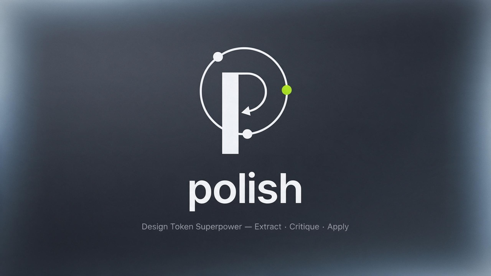
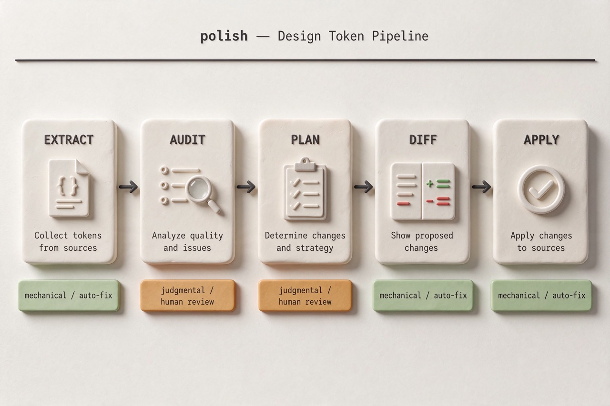

[English](README.md) | [中文](README.zh-CN.md)

# polish — 设计令牌超能力工具

**提取 · 审查 · 应用** — 一个零依赖工具包，闭环管理 CSS 自定义属性（设计令牌）。它扫描样式表中的令牌问题，对每条发现进行分类，自动应用机械性修复，同时将需要人工判断的问题标记出来交由人工决定。

可作为 CLI、AI 编程代理的 MCP 服务器，或 Node.js 模块使用。

**面向**已使用 CSS 自定义属性、需要在项目增长时保持其一致性的前端工程师和设计系统维护者。

**仓库**：[https://github.com/maxdeng007/polish-design-tokens](https://github.com/maxdeng007/polish-design-tokens)



## 问题

设计令牌——如 `--color-primary` 这样的 CSS 自定义属性——强大但脆弱。随着项目增长，令牌会发生漂移：硬编码颜色悄然出现，不同名称下出现重复值，引用悬空，层叠覆盖悄然破坏一致性。手动检测这些问题很繁琐，修复则更甚。

**polish** 将审计 → 修复流水线自动化：

1. **提取** — 扫描 CSS/HTML 文件，构建声明图
2. **审查** — 交叉比对声明与引用，发现问题
3. **应用** — 为机械性修复生成并执行补丁，附带备份

**范围说明：** polish 检测的 12 类发现中，仅 `duplicate-value` 会被自动修复。其余 11 类会被标记，交由人工或 AI 代理审查——polish 告诉你哪里有问题，但如何修复的决定权在你。

## 为什么不用 Stylelint 或 ESLint？

Stylelint 和 ESLint 能捕获语法错误和风格规则违规，但它们不理解令牌之间的关系。它们无法告诉你 `--background` 与 `--bg` 重复，也无法告诉你引用的令牌从未被声明。polish 构建声明图并交叉比对，精准定位这些结构性令牌问题——然后自动修复机械性问题，将其余标记供你判断。

机械/判断分流是核心理念：有唯一安全答案的问题自动修复；需要决策的问题会被暴露出来，绝不静默打补丁。

## 安装

**从 npm 安装**（推荐）：

```bash
npm install -g polish-design-tokens
```

或作为项目依赖：

```bash
npm install polish-design-tokens --save-dev
```

**从 GitHub 安装**（如果你想要最新源码）：

```bash
git clone https://github.com/maxdeng007/polish-design-tokens.git
cd polish-design-tokens/polish-mono
npm install -g .
```

需要 Node.js ≥ 18。

## 通过 AI 安装（无需编程）

**适合非技术用户。** 如果你对上面的命令行不太熟悉，可以直接跳过。复制下方提示词，粘贴到任意 AI 聊天工具（ChatGPT、Claude 等）中，AI 就会帮你安装 polish 并审计你的项目——无需编程。

```text
请帮我用 "polish" 工具审计我项目中的设计令牌。

1. 运行以下命令全局安装 polish 工具：
   npm install -g polish-design-tokens

2. 对我以下项目目录运行审计：
   [在此处粘贴你的项目路径]

3. 用设计师能听懂的通俗语言汇报你的发现：
   - 存在哪些令牌问题（硬编码颜色、重复值、
     悬空引用、冲突等）
   - 哪些问题可以自动修复，哪些需要我来决定
   - 给出清晰的总结——不要原始 JSON

不要应用任何修复或修改任何文件。只安装、审计并汇报。
```

**下一步：** 审计完成后，polish 会持续保留在你的系统上——无需重新安装。如果你想应用机械性修复（重复值），只需给 AI 发送一条后续提示，例如：*"现在对我的项目应用机械性修复，带备份。"* AI 会重新运行审计、生成补丁，并自动带备份应用。

## 可选技能

polish 零依赖，开箱即用。以下四个可选技能与工具可增强体验——均非令牌审计所必需。运行 `polish doctor` 检查已安装项，缺失的技能会附带可直接执行的安装命令。对 doctor 使用 `--install` 可自动安装缺失项。

| 技能 / 工具 | 功能 | 如何与 polish 配合 |
|---|---|---|
| `awesome-design-md` | 54 个现成 DESIGN.md 文件，涵盖 Vercel、Stripe、Linear、Notion 等品牌 | 驱动 `polish_style_lookup`——按品牌查询设计令牌（配色、字体、间距），获取特定视觉风格 |
| `dembrandt` | 设计令牌分析与分类工具 | 互补的令牌工具——polish 审计你的项目，dembrandt 协助分类和规范化令牌数据 |
| `taste` | 前端艺术指导与设计品味 | 当 polish 标记判断性问题（硬编码颜色、命名冲突、层叠覆盖等）时，辅助做出设计决策 |
| `impeccable` | 生产级前端界面生成 | 生成使用你令牌的高质量 UI，与 polish 的审计→修复流水线协同工作 |

四者均为可选。polish 无需任何一项即可完成完整的令牌审计——按需安装匹配你工作流的技能即可。

## 快速开始

**适合 CLI 用户。** 标准的四步流水线：

```bash
# 1. 审计项目中的令牌问题
polish audit ./my-project --ignore=node_modules,dist > findings.json

# 2. 将发现转换为排序后的计划
polish plan findings.json > plan.json

# 3. 生成机械性补丁
polish diff plan.json > patches.json

# 4. 应用补丁（自动创建 .backup 文件）
polish apply patches.json --target=./my-project
```

**或者直接运行 `polish`（不带参数）** 即可启动交互式向导——它会逐步引导你完成全部五个步骤，每步都有确认提示，无需记忆 JSON 文件或命令参数。详见下方 [交互式向导](#交互式向导)。

**一键命令。** 无需串联 JSON 文件，快速、可重复使用：

```bash
# 只读健康检查——发现错误时退出码为 1，适合 CI
polish check ./my-project

# 一键修复——扫描、应用机械性补丁并备份，其余问题标记供你审查
polish fix ./my-project

# 预览修复但不修改文件
polish fix ./my-project --dry-run

# 生成交互式 HTML 报告——浏览器打开即可，勾选决策
polish report ./my-project
```

`polish check` 绝不修改文件——可安全用于 CI、pre-commit 钩子，或任何需要快速令牌健康快照的场景。`polish fix` 将完整的审计 → 计划 → 补丁 → 应用流水线合并为一条命令，仅应用机械性修复，并标记判断性问题供你审查。`polish report` 生成一个自包含的 HTML 文件，可直接分享给设计师——按严重程度着色展示发现，并为简单决策（删除孤儿令牌、别名重复值）提供复选框；勾选后下载 `decisions.json`，即可交给 `polish confirm` 执行。

## AI 代理部署

**适合 AI 编程代理。** 最常见的工作流：将 GitHub 仓库地址交给你的 AI 编程代理（Qoder、Claude 等），让它设置并运行 polish。代理会：

1. 克隆仓库或从 npm 安装
2. 注册 MCP 服务器（见下文）
3. 使用 `polish_audit` 扫描目标项目
4. 使用 `polish_plan` → `polish_diff` → `polish_apply` 修复机械性问题

所有 `polish apply` 操作在修改任何文件前都会创建 `.backup` 备份文件。失败的补丁会被记录且不会中断批量操作——请检查 apply 报告以查看失败项。

## 流水线

polish 分为三个阶段。每个阶段读取上一阶段的输出，因此你可以运行完整链路，也可以在任何节点停止。

```
findings.json → [polish plan] → plan.json → [polish diff] → patches.json → [polish apply] → 文件
```

### 1. 计划 — 分类与排序

接收发现（来自 `polish_audit`），生成有序的操作队列。每条发现被分类为：

- **机械性（Mechanical）** — 可安全自动修复。无需人工决策。
- **判断性（Judgmental）** — 需要人工判断。提交人工审查。

发现按优先级排序：

| 优先级 | 类型 | 描述 | 分类 |
|----------|------|-------------|----------------|
| 1 | `conflict` | 根作用域内同一令牌名有不同值 | 判断性 |
| 2 | `dangling` | 令牌被引用但从未声明 | 判断性 |
| 3 | `runtime-drift` | 运行时跨页面令牌值不一致 | 判断性 |
| 4 | `orphan` | 已声明但从未被引用 | 判断性 |
| 5 | `duplicate-value` | 多个令牌名共享同一值 | 机械性 |
| 6 | `namespace` | 多种命名族共存 | 判断性 |
| 7 | `hardcoded` | 直接使用原始颜色/间距值而非令牌引用 | 判断性 |
| 8 | `cascade-override` | CSS 层叠产生非预期的变异 | 判断性 |
| 9 | `state-variation` | 令牌值在不同组件状态间变化 | 判断性 |
| 10 | `theme-variation` | 令牌值在不同主题间变化 | 判断性 |
| 11 | `dynamic-variable` | 具有动态（非静态）值的令牌 | 判断性 |
| 12 | `tailwind-utility-var` | Tailwind v4 单工具变量 | 判断性 |

只有**机械性**发现（`duplicate-value`）会在下一阶段生成补丁。

### 2. 差异 — 生成补丁

读取计划，仅为机械性条目生成具体补丁。每个补丁指定：

- **type**：`replace`（前 → 后）、`add`（插入新声明）、`rename` 或 `rewrite`
- **file** / **line**：精确位置
- **before** / **after**：精确的文本变更
- **reason**：人类可读的解释

`duplicate-value` 的补丁针对**次要**令牌的位置，将其别名到主要令牌——绝不针对主要令牌本身（防止自引用别名）。

### 3. 应用 — 带备份执行

应用补丁到文件，带自动备份保护。每个文件在修改前都会备份。结果报告已应用的内容和任何失败。

## 输入

polish 只读取**本地文件**——不联网抓取 URL 或在线资源。

`target` 参数接受**目录路径**（推荐）或**单个文件路径**。传入目录时，polish 递归扫描其中所有支持的文件，自动跳过常见构建与依赖目录（`node_modules`、`dist`、`.git` 等）和二进制文件。

CLI、MCP 和 Node.js API 三种入口使用相同的 `target` 参数。

## CLI 用法

```bash
polish                                  # 启动交互式向导
polish wizard [--target=dir] [--ignore=a,b]  # 带确认提示的引导式流水线
polish audit  <target> [--ignore=a,b] [--summary]  # 扫描并输出发现
polish check  <target> [--ignore=a,b]              # 健康检查：只读摘要，退出码表示是否有错误
polish fix    <target> [--ignore=a,b] [--dry-run]  # 一键修复：自动应用机械性补丁并备份
polish report <target> [--ignore=a,b] [--output=f] # 生成交互式 HTML 报告
polish plan  <findings.json> [--summary]   # 将发现转换为有序操作列表
polish diff  <plan.json> [--summary]       # 从计划生成机械性补丁
polish apply <patches.json> [--summary]    # 应用补丁（创建 .backup 文件）
polish rollback <backups.json> [--target=dir] [--summary]  # 从 apply 运行的备份清单恢复文件
polish confirm <decisions.json> [--target=dir] [--summary]  # 应用设计师确认的判断性决策
polish doctor [--install] [--summary]      # 检查可选依赖；--install 自动安装缺失项
polish explain <finding-type>              # 解释某类发现的含义与修复方法
polish mcp                     # 启动 MCP 服务器（stdin/stdout 上的 JSON-RPC）
```

**`--summary`** 以人类可读的摘要替代原始 JSON 输出——在终端查看结果时非常理想。适用于所有命令：

```bash
polish audit ./my-project --summary
# 令牌审计摘要
# ...
# 发现 130 个问题：
#   [判断性] 10 个 conflict
#   [机械性] 34 个 duplicate-value
# ...
```

当输出到终端时，发现会按严重程度**着色显示**——错误为红色，警告为黄色，信息为绿色。输出被管道或重定向时颜色会自动关闭。

**`--install`**（仅 doctor）自动安装缺失的可选依赖。不加此标志时，doctor 仅报告缺失项并展示需手动执行的安装命令：

```bash
polish doctor              # 检查已安装项，对缺失项展示安装命令
polish doctor --install    # 检查并自动安装缺失的可选依赖
```

**`polish explain`** 打印任意发现类型的通俗解释——含义、为何重要、如何修复。在报告中看到某个发现类型时，无需查阅文档即可快速理解：

```bash
polish explain conflict
polish explain hardcoded
```

**`polish confirm`** 应用设计师确认的判断性决策——这些是 `polish diff` 无法自动修复、需要人工判断的发现。传入一个决策 JSON 文件和目标目录，polish 会重新扫描目标、将每条决策解析为补丁，并带备份保护地执行。

```json
// decisions.json
{
  "decisions": [
    { "action": "delete", "token": "--primary" },
    { "action": "alias", "from": "--heading", "to": "--text" },
    { "action": "rename", "from": "--bg", "to": "--background" }
  ]
}
```

```bash
polish confirm decisions.json --target=./my-project --summary
```

支持三种决策动作：

| 动作 | 效果 | 用途 |
|------|------|------|
| `delete` | 删除令牌声明 | 孤儿令牌 |
| `alias` | 将值替换为 `var(--to)` | 有选定主令牌的重复值 |
| `rename` | 跨文件重写所有出现处 | 命名空间碎片化 |

同样的决策也可以通过向导的**确认**步骤（第 3 步，共 5 步）交互式收集。

**`polish report`** 生成一个自包含的交互式 HTML 报告——在任意浏览器中打开，无需命令行或 JSON 即可审查发现。发现按严重程度着色，并分为错误/警告/信息三组。每张卡片展示发现类型、文件与行号、证据和建议；颜色值旁渲染色块，可一眼识别颜色。简单决策（删除孤儿令牌、别名重复值）配有复选框——勾选你同意的项，点击**下载**或**复制 decisions.json** 导出。报告同时给出下一步要运行的 `polish confirm` 命令，也可以把 `decisions.json` 交给 AI 代理执行。

```bash
polish report ./my-project                        # 在目标目录写入 polish-report.html
polish report ./my-project --output=report.html   # 写入指定路径
polish report ./my-project --ignore=node_modules  # 跳过目录
```

HTML 完全自包含——不依赖外部 CSS、JS 或网络请求——可邮件分享、放入仓库或离线打开。

## 交互式向导

不带参数运行 `polish`（或运行 `polish wizard`）即启动交互式向导，逐步引导你完成完整流水线——审计、计划、确认、补丁、应用——每一步都有确认提示。无需重定向 JSON 文件，无需记忆命令参数。

```bash
polish
# ▸ polish — 设计令牌超级工具
#
# 第 1 步：审计
# 要扫描的项目目录 [.]: .
# 正在扫描...
#   发现 130 个问题：10 个 conflict，34 个 duplicate-value，……
# 继续构建操作计划？[Y/n/q] y
#
# 第 2 步：计划
#   10 个判断性操作（建议人工审查）
#   34 个机械性操作（可自动修复）
# 继续审查决策并生成补丁？[Y/n/q] y
#
# 第 3 步：确认
#   2 个判断性发现需要你的决策：
#   删除 --primary？[y/N/q] y
#   ✓ 将删除 --primary
#   1 个补丁来自已确认的决策
#
# 第 4 步：补丁
#   已生成 35 个补丁（34 个机械性 + 1 个已确认）。
# 立即应用这些补丁？[Y/n/q] y
#
#   ✓ 已应用 35 个补丁，0 个失败
#   已创建 2 个备份文件
# 完成。
```

每一步都可以回答 **y**（继续）、**n**（跳到下一步）或 **q**（完全退出——不做任何更改）。也可以传入 `--target=dir` 和 `--ignore=a,b` 来跳过初始的目录与忽略模式提示。

向导在你确认应用之前不会修改任何文件。即使确认应用，每个被修改的文件也会先以 `.backup` 后缀备份，再写入更改。

不加 `--summary` 时，所有命令输出原始 JSON，便于管道传递和程序化使用。

## MCP 服务器

polish 通过 Model Context Protocol 暴露 9 个工具，因此任何 AI 编程代理（Qoder、Claude 等）都能驱动完整流水线。

添加到你的 MCP 配置（`mcp.json`、`.mcp.json` 或你的代理配置）：

```json
{
  "mcpServers": {
    "polish": {
      "command": "polish",
      "args": ["mcp"]
    }
  }
}
```

如果 `polish` 不在代理的 PATH 中，改用 `npx`：

```json
{
  "mcpServers": {
    "polish": {
      "command": "npx",
      "args": ["-y", "polish-design-tokens", "mcp"]
    }
  }
}
```

可用工具：

| 工具 | 描述 |
|------|-------------|
| `polish_extract` | 从目录中提取令牌声明 |
| `polish_audit` | 扫描 + 交叉比对，生成发现 |
| `polish_measure` | 为审计规范化运行时观测数据 |
| `polish_plan` | 将发现转换为排序后的分类操作队列 |
| `polish_diff` | 从计划生成机械性补丁 |
| `polish_apply` | 带备份保护执行补丁，失败时自动回滚 |
| `polish_rollback` | 从 apply 运行的备份清单恢复文件 |
| `polish_doctor` | 检查可选依赖和环境健康状态 |
| `polish_style_lookup` | 查询品牌 DESIGN.md 设计令牌数据 |

## Node.js API

```javascript
import { plan, generateDiffs, apply } from 'polish-design-tokens';
import { extract, audit, runPipeline, measure, runWizard } from 'polish-design-tokens';

// 完整流水线：扫描 → 审计 → 计划 → 差异（不应用）
const { graph, findings, plan, patches } = runPipeline('./my-project');

// 交互式向导（审计 → 计划 → 差异 → 应用，带确认提示）
const wizardResult = await runWizard({ target: './my-project' });

// 手动逐步操作
const graph = extract('./my-project');
const report = audit('./my-project');
const actions = plan(report.findings);
const patches = generateDiffs(actions);
const result = await apply(patches);
```

### API 参考

| 函数 | 签名 | 描述 |
|----------|-----------|-------------|
| `extract` | `(target: string, ignore?: string[]) → DeclarationGraph` | 扫描目录中的令牌声明和引用 |
| `audit` | `(target: string, ignore?: string[], observation?: RuntimeObservation) → AuditReport` | 扫描 + 交叉比对，生成发现 |
| `runPipeline` | `(target: string, ignore?: string[], observation?: RuntimeObservation) → PipelineResult` | 完整流水线：提取 → 审计 → 计划 → 差异（不应用） |
| `scan` | `(target: string, ignore?: string[]) → DeclarationGraph` | 底层扫描，与 `extract` 相同 |
| `cross` | `(graph: DeclarationGraph, observation?: RuntimeObservation) → AuditReport` | 从声明图判定发现 |
| `measure` | `(docs?: unknown[]) → RuntimeObservation` | 为审计规范化运行时观测数据 |
| `plan` | `(findings: Finding[]) → PlanAction[]` | 将发现排序分类为操作队列 |
| `generateDiffs` | `(planItems: PlanAction[]) → Patch[]` | 从计划生成机械性补丁 |
| `apply` | `(patches: Patch[], target?: string) → Promise<ApplyResult>` | 带备份保护应用补丁（target 默认为 cwd） |
| `confirm` | `(decisions: Decision[], graph: DeclarationGraph) → Patch[]` | 将设计师确认的决策解析为补丁 |
| `generateReport` | `(report: AuditReport) → string` | 生成自包含的交互式 HTML 报告 |
| `runWizard` | `(opts?: WizardOptions) → Promise<WizardResult>` | 交互式引导流水线，带确认提示 |

已内置 TypeScript 类型定义——无需 `@types` 包。所有类型从包根目录导出。

### 格式支持

polish 扫描以下文件类型。每种类型均解析 CSS 自定义属性声明和 `var()` 引用：

| 文件类型 | 扩展名 | 提取内容 |
|-----------|-----------|-------------------|
| CSS | `.css` | 所有 `--name: value` 声明和 `var(--name)` 引用 |
| SCSS / LESS | `.scss`, `.less` | 与 CSS 相同 |
| HTML | `.html`, `.htm` | `<style>` 块、内联 `style=""` 属性、`<script>` 样式对象 |
| JavaScript / TypeScript | `.js`, `.ts`, `.jsx`, `.tsx`, `.mjs`, `.cjs` | 内联样式对象和 `setProperty()` 调用；JSX 文本内容会被忽略 |
| Vue / Svelte | `.vue`, `.svelte` | `<template>` 内联样式、`<script>` 样式对象、`<style>` 块 |

`node_modules`、`dist`、`build`、`.git`、`.next`、`.cache` 及其他常见构建/依赖目录中的文件会自动跳过。使用 `ignore` 选项可排除更多路径片段。

### MCP 集成详情

所有 9 个 MCP 工具均接受和返回 JSON。关键参数：

- **`polish_extract`** — `{ target: string, ignore?: string[] }` → `DeclarationGraph`
- **`polish_audit`** — `{ target: string, ignore?: string[], observation?: object }` → `{ findings, summary, graphSummary, observation }`
- **`polish_measure`** — `{ documents: unknown[] }` → `RuntimeObservation`
- **`polish_plan`** — `{ findings: Finding[] }` → `{ plan, summary }`
- **`polish_diff`** — `{ plan: PlanAction[], target?: string }` → `{ patches, preview }`
- **`polish_apply`** — `{ patches: Patch[], target: string }` → `ApplyResult`
- **`polish_rollback`** — `{ backups: { file, backup }[], target: string }` → `RollbackResult`
- **`polish_doctor`** — `{}` → 依赖健康检查
- **`polish_style_lookup`** — `{ brand?: string }` → 品牌设计令牌参考

当未找到外部 skill 文件时，`polish_style_lookup` 工具回退到内置品牌数据（Vercel、Stripe、Linear、Notion、Anthropic、GitHub、shadcn、Figma），使其在任何机器上无需额外设置即可工作。

## 静态分析 vs 运行时分析

**polish-design-tokens** 执行**静态分析**——它扫描源文件（CSS、SCSS、HTML、JS/TS）以查找令牌声明、引用和冲突。这适用于任何项目、任何环境，无需额外设置。

**运行时测量**（在真实浏览器中检查实际渲染值）通过本包导出的 `measure()` 函数提供。它检测只有在真实浏览器中评估令牌时才出现的 `runtime-drift` 和 `hardcoded` 发现。这需要 Chrome DevTools 可用。如果你不想直接调用该函数，配套的浏览器自动化 MCP 包可以封装 `measure()` 提供现成工具。

对于大多数用例——审计项目源码、修复机械性问题、验证令牌一致性——`polish-design-tokens` 中的静态流水线已经足够。当你需要验证用户在浏览器中实际看到的内容时，请使用 `measure()`（或浏览器自动化配套工具）。

## 能发现什么

**机械性（可通过 `polish diff` + `polish apply` 自动修复）：**

- **`duplicate-value`** — 两个或更多令牌名共享同一值。修复：将次要令牌别名到主要令牌。

**判断性（标记供人工审查，不自动生成补丁）：**

- **`dangling`** — 令牌被引用但从未声明。需要提供规范值——自动插入 `inherit` 可能产生无效或损坏的 CSS。
- **`hardcoded`** — 直接使用原始颜色或间距值而非令牌引用。需要选择映射到哪个令牌。仅运行时测量（`measure()`）可发现，静态扫描不会产生此类发现。
- **`conflict`** — 同一令牌名以不同值声明。需要选择规范值。
- **`cascade-override`** — 普通 CSS 层叠产生非预期的值变异。需要决定重构还是接受。
- **`namespace`** — 多种命名约定共存（如 `--color-*` 和 `--bg-*`）。需要统一命名。
- **`orphan`** — 已声明但从未被引用。需要决定删除还是保留。
- **`runtime-drift`** — 运行时测量时令牌值在不同页面间不同。需要调查源头。仅运行时测量（`measure()`）可发现，静态扫描不会产生此类发现。
- **`state-variation`** — 令牌值在不同组件状态间变化（如 `:hover`、`:focus`）。需要决定是否拆分为独立令牌还是接受变化。
- **`theme-variation`** — 令牌值在不同主题间变化（如深色/浅色）。需要决定是否规范化主题结构。
- **`dynamic-variable`** — 具有动态（非静态）值的令牌，如运行时计算的值。需要决定如何处理动态行为。

## 故障排查

**`polish_style_lookup` 返回 `found: false`**
未找到外部 design-md skill 文件，且未提供品牌名。传入 `brand` 参数（如 `"vercel"`、`"stripe"`）以使用内置品牌数据，或安装 awesome-design-md skill 以获得完整覆盖。

**`polish apply` 报告 `before text not found`**
补丁的 `before` 字符串与文件内容不完全匹配——空白、引号或行内容可能有差异。检查 `.backup` 文件（在每次应用前创建），并从新的审计重新生成补丁。

**没有观测数据却出现 `runtime-drift` 发现**
运行时发现（`runtime-drift`、`hardcoded`）需要来自 `measure()` 的 `RuntimeObservation`。仅静态审计不会产生它们。调用 `measure()` 传入浏览器观测到的变量数据，并将其作为 `observation` 参数传给 `audit()` 或 `cross()`。

**大型项目扫描缓慢**
扫描器零依赖且单线程。对于包含数千文件的项目，使用 `ignore` 选项排除不包含令牌的目录。二进制文件（通过空字节检测）会自动跳过。

## 性能说明

- **扫描** 为 O(n × m)，其中 n 为文件数，m 为平均文件大小。解析器对 CSS 使用单遍状态机，对 HTML/JS 使用基于正则的提取——无 AST 解析开销。
- **交叉比对** 在最坏情况下为 O(d²) 用于冲突检测，其中 d 为每个令牌名的声明数。实践中，大多数令牌少于 10 个声明，因此可忽略不计。
- **应用** 对每个文件只读一次、只写一次，无论有多少补丁针对它。每个文件只创建一次备份。
- 工具具有**零运行时依赖**——运行时无需 npm install，除包本身外。

## 为何使用

- **闭环** — 提取 → 审查 → 应用，无需手动打补丁
- **安全** — 仅自动应用机械性修复；判断性问题被标记
- **有备份** — 任何应用前自动备份文件
- **代理就绪** — MCP 协议让任何 AI 编程代理都能驱动流水线
- **零依赖** — 纯 JavaScript，在任何运行 Node.js 的地方都能工作

## 仓库结构

| 目录 | 描述 |
|-----------|-------------|
| `polish-mono/` | 统一 npm 分发包（`polish-design-tokens`）——核心工具、CLI、MCP 服务器、测试 |
| `examples/` | 包含已知令牌问题的示例项目 |
| `docs/` | 设计规格和实现计划 |

## 示例

参见 [`examples/walkthrough/`](https://github.com/maxdeng007/polish-design-tokens/tree/main/examples/walkthrough/)——在演示项目上运行完整流水线（审计 → 计划 → 差异 → 应用）的完整可执行演练，包含真实流水线输出、可视化流程图和终端截图。

另见 [`examples/legacy-token-audit/noah-sample/`](https://github.com/maxdeng007/polish-design-tokens/tree/main/examples/legacy-token-audit/noah-sample/)——token-audit 时代的归档产物：覆盖所有发现类型的丰富测试用例，包含重复值、硬编码颜色和悬空引用的真实样式表。由旧工具生成，仅供参考。

## 许可证

MIT
